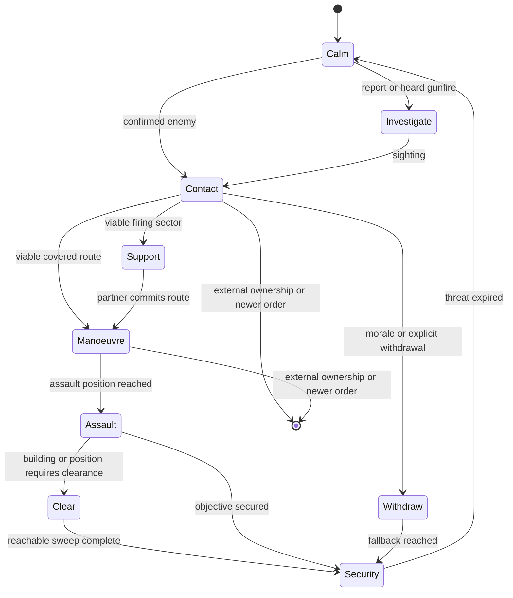

# WAIT Cortex operations

> **Use this page when:** you need to understand or configure WAIT's automatic
> group-level behaviour during contact, movement and recovery.

## Purpose and limits

Cortex is WAIT's optional automatic-tactics layer. It augments native AI only
when an eligible non-player group has a useful combat opportunity. It is not a
replacement for authored mission orders, Zeus commands or another controller
that has claimed the same actors.

CBA is required and provides the configuration authority. ZEN is optional; native
Zeus orders work without it. Configure behaviour from **Options > Addon Options
> Waldos AI Tweaks**, under **General**, **Infantry**, **Coordination**,
**Vehicles**, **Convoys**, **Aircraft**, and **Support and civilians**.

The CBA master setting **Enable Cortex automatic tactics** is on by default.
Each family also has its own gate. A setting marked **Live** is adopted by the
next owner-local update; a setting marked **Next operation** is guaranteed for
a new action without discarding a committed action halfway through.

## Ownership and interruption

One controller owns movement at a time. WAIT creates a finite operation only
when it can own the affected action. The operation records an intent,
generation, owner locality, participants, route, physical progress and a
cancellation reason.

WAIT immediately releases a conflicting operation when any of these occurs:

- a Zeus edit, move, waypoint, remote-control action or explicit native order;
- player control of the actor;
- a newer mission order;
- locality migration or an external controller marker;
- a lost target, impossible route, casualty collapse or safety failure.

Release removes only movement, postures, speed limits and state previously
owned by that operation. It does not restore an older formation, seat
assignment or waypoint over a newer external decision.

## Contact flow

A bounded owner-local engine danger FSM records immediate observations and
wakes the group's single shared decision job. A valid first event can start that
brain immediately instead of waiting for the periodic discovery sweep. The FSM
terminates after draining its short engine queue and does not add a per-unit
permanent movement loop or movement owner.

## Infantry actions

| Action | Expected behaviour | Completion or release |
| --- | --- | --- |
| Investigate | A suitable element checks an approximate reported or heard location while the group retains security. | Sighting, arrival, time limit, new order or loss of route. |
| Advance | Where numbers permit, a moving element makes short covered bounds while a partner covers. Fire remains native and may continue while moving. | Objective progress, contact change, no-progress recovery exhausted or handover. |
| Flank | Selects a distinct left/right corridor that progresses on the threat without crossing a friendly firing lane. | Side approach reached, target change, unsafe route or handover. |
| Assault | A manoeuvre element continues forward from its assault position while support holds only while its firing sector remains safe. A fresh known threat already too close for advance or flank enters this paired-element operation directly. | Position secured, target lost, casualty collapse, blocked route or handover. |
| Withdraw | A broken element selects a screened route away from the threat. Smoke is optional and never blocks movement. | Physical fallback, bounded incomplete result, newer order or handover. |
| Regroup | Separated survivors close only when they remain unreserved and the tactical situation allows it. | Cohesion, time limit, contact or handover. |

A grenade, smoke throw, straggler or individual recovery cannot freeze the rest
of an operation. WAIT makes one local recovery attempt for a stalled actor;
then marks that actor unavailable and lets the capable element continue. It
never teleports, repairs, unflips or grants immunity as a recovery shortcut.

## Coordination and combined arms

Nearby friendly groups coordinate only when they share compatible intent,
threat knowledge and communication eligibility. The coordinator assigns
short-lived support and manoeuvre roles, offset rally areas and distinct
approach corridors. It rejects routes that cross a partner's firing lane.

A support opportunity adds to ordinary combat; it does not require a scheduled
assembly or override a valid authored order. Roles expire after no physical
progress, target change, casualty collapse, lost communication or external
handover. Vehicles and aircraft can support the same opportunity only when
their own capability and ownership checks pass.

## Buildings

Cortex building actions use a finite physical progression:

1. enumerate entrances, exits and reachable interior positions;
2. choose an entry with a viable approach and safe support sectors;
3. assign a limited entry element, interior lanes and exterior security;
4. record a room only after physical arrival in its position radius and floor;
5. retry a blocked position through another entrance, route or actor;
6. report exhausted positions as unreachable and finish `INCOMPLETE`, never as
   fabricated success.

**Clear** sweeps reachable interior positions then establishes security.
**Garrison** occupies defensible interior positions with exterior security. Walking is the default.
Mission scripts can explicitly request instant interior placement with
`[group soldier1, getPosATL house1, 40, createHashMapFromArray [["teleport",true]]] call WAIT_fnc_CortexGarrison;`.
This option runs once on the group owner during a fresh order, using the same interior slot selection;
owner adoption and JIP do not replay it. Surplus actors still approach exterior security normally.
Players, remote-controlled/protected actors, movement reservations and native service tasks are excluded
from instant placement. `inPlace` and `teleport` cannot be combined. Instant placement is not evidence
of accessible interiors or physical CQB entry and must remain excluded from physical routing acceptance.
The executor option has offline checks only; fresh engine placement, repeat, casualty and migration
acceptance remains pending. The Garrison area module labels walking and instant placement distinctly; module controls are described below.
**Traverse** enters through one viable side and leaves through an actual exit
on the onward side. Casualties and stalls can rotate capable reserve actors into
the entry element without forcing a group merge.

## Vehicles and convoys

General driving assistance is separate from registered convoy control. General
driving retains native waypoints and applies sparse speed/terrain observation
plus one bounded physical recovery. Convoys add an ordered vehicle column,
predecessor-trail spacing and contact/passenger policy.

Driving assistance requires a real authored waypoint. The implicit spawn waypoint does not admit it.
The recovery identity uses the shared full waypoint receipt: conditions, timeouts, synchronized
triggers/waypoints, script, attachment, house position, loiter parameters, speed, combat mode and
formation. Attached target motion retains object identity rather than resetting recovery on each
position update. A same-index edit resets recovery observation before another attempt. Every
speed or recovery write rechecks that the waypoint identity is still current. An initial refusal
clears an unapplied speed snapshot. This source guard has no fresh physical acceptance. Retests must
include condition/trigger edits during reverse recovery and a valid new route after the change.
Recovery refresh/reverse is limited to plain MOVE orders with no activation code, waypoint script,
timeout, attached target, waypoint synchronization or inactive trigger. This applies at every
distance, including far outside the native waiting envelope. Safety speed caps and native order
execution remain available; WAIT does not evaluate authored code or bypass synchronization.
Distant scripted/timed/attached orders require physical retesting alongside ordinary recovery.

Only the vehicle currently carrying the group leader may refresh or reverse the shared native
route. Other group vehicles retain native formation movement and can still receive terrain speed
caps. Losing the leader role resets an existing recovery stage and its observation timer before
any reverse-speed cap is selected. Each command also checks current vehicle/group locality and the
actual driver/commander seat identities. This does not cancel an already-issued native movement
command by issuing a competing stop. Physical tests must cover formation waits, leader replacement
while recovering, seat changes during observation and subsequent valid leader recovery.

Ordinary driving now has a route-scoped owner-local operation FSM. Group decisions admit or
reuse it; the existing shared scheduler executes its cruise, deliberate-wait and recovery samples.
Epoch, current-brain identity and the authored route receipt fence callbacks. A newer route retires
old speed leases before fresh admission. Group release, disablement, Zeus/external takeover,
locality loss or loss of eligible vehicles ends the operation. Exhausted recovery retains a terminal
receipt for that exact order so discovery cannot restart the same attempts. A changed order or an
explicit group handback can admit fresh work.

A stationary native-ready vehicle within the completion radius plus 50 metres is treated
conservatively as waiting when its waypoint is HOLD, has an inactive synchronized trigger, a
positive timeout or a nontrivial condition. The condition is read as text and never executed by
WAIT. The guard resets recovery observation while waiting; native waypoint processing still decides
when movement resumes. This envelope is a recovery guard, not proof of arrival, condition truth or
successful navigation. Terrain speed assistance remains separate from route recovery.

No new settings, dependencies or vehicle polling loops are added. The FSM queues one coalesced
sample every four seconds and yields to the existing tactical pause. It reports its semantic state
in `WAIT_Driving_State`; this is observation, not physical acceptance. Predictive traffic, gate
execution, yielding and overtaking remain open work. Required physical retests include trigger,
condition and timeout waits near and far from the waypoint; same-order exhaustion; newer orders;
repeat use; disabled/re-enabled control; and owner migration. Audits are held, so these are unrun.

Ordinary recovery and tracked withdrawal now share a fresh rear-clearance observer. It samples
three positions across the real hull width at two body-relative heights, from the rear body edge.
Nearby actor footprints are projected into that corridor, so a long or angled vehicle can block a
reverse even when its centre sits outside it. More than 64 nearby actors refuses clearance rather
than dropping unexamined candidates. Each call returns the clearance reason, observation time and
ray count; it issues no movement or physics commands and retains no reusable clearance cache.

Ordinary recovery checks its eight-metre leg before the native command. Tracked withdrawal checks
its speed-dependent rear distance at each existing reverse step. The ordinary terrain/water guard
and tracked avenue/facing/deadline gates remain. Six sampled rays are not a complete navigation or
collision guarantee; native movement remains responsible for steering. No new settings or loops
are added. Physical wide-hull, angled-truck, pedestrian, wreck, low barrier, pitch/slope and dense
traffic cases remain unrun while audits are held. Convoy traffic prediction is separate open work.

Finite tactical movement acquisition now retires the ordinary driving FSM and its unchanged
speed leases before publishing the successor owner. Ordinary admission, queued execution and each
command reject an unexpired movement lease or a current tracked reverse. Late cleanup preserves
the successor's speed policy. Expired leases do not permanently exclude ordinary driving. This
handover has no new controls; withdrawal/standoff/jink/orientation and post-expiry resumption need
physical testing, including an acquisition while an ordinary callback is pending.

Convoys measure forward predecessor gaps to remain single-file; they do not use
formation wedge offsets. Target spacing uses a size-aware minimum/maximum band
with damped speed correction. A meaningful stop is classified as ordered,
contact, spacing, obstruction, immobile or external owner and is reported once
to Zeus. Player-made roadblocks remain valid stops.

Operating crews stay aboard. Cargo dismounts and remounts only while their
convoy task generation still owns them; a newer Zeus task wins immediately.

## Diagnostics

The diagnostic view exposes the active intent, owner, generation, phase,
participants, route, physical-progress age, recovery state, external owner,
scheduler latency, skipped work, replans and final cancellation reason. Use it
to diagnose a real action before changing a setting.

Static validation confirms interfaces, bounded contracts and configuration
parity. It does not prove pathfinding, combat, building entry, convoy recovery
or air combat. Those require the packaged, damage-enabled audit batches.

## Related documentation

- [Settings reference](SETTINGS-REFERENCE.md)
- [Capability registry](CAPABILITY-REGISTRY.md)
- [Addon lifecycle](ADDON-LIFECYCLE.md)
- [Modding and operations](MODDING-AND-OPERATIONS.md)

<!-- WAIT-WIKI-NAV -->
---
[Wiki home](https://github.com/AdamWaldie/WaldosAITweaks/wiki/Home) · [Installation and setup](../README.md) · [Capability registry](CAPABILITY-REGISTRY.md)

### Passenger remount cooperation

With `WAIT_AIPass_Vehicles_Enable` and `WAIT_AIPass_VehicleRemount_Enable` enabled,
calm restoration retains an owned passenger boarding episode for up to 60 seconds.
Only passengers dismounted by WAIT are eligible. A new assigned vehicle, Zeus control,
contact or a conflicting operation retires or suspends the old intent rather than
sending passengers back to their original transport.

The passenger group owner requests a stop from the original vehicle owner while an
eligible passenger remains within 100 metres. Each request lasts at most 30 seconds
and never exceeds the boarding deadline. The vehicle owner checks the public boarding
record, group ownership, side, original vehicle, live settings and current assignment.
It considers at most eight passenger records. Crew contact or an active vehicle movement
lease rejects a boarding stop. Actual boarding uses native assignment and get-in orders;
no passenger is moved directly into a seat.

A completed boarding, reassignment or expired request releases the stop. WAIT restores
the prior forced speed only when the current forced speed still equals its own stop.
This uses existing group scheduler callbacks and adds no persistent worker. The record
is public for owner migration; a new owner validates live eligibility before commanding.
Stationary separate-group boarding and replacement-vehicle boarding have physical audit
evidence. Moving-vehicle boarding, interruption and migration of this handshake remain
queued for physical acceptance.

### Interior access recovery priority

A stalled interior access checkpoint uses its existing finite recovery before the controller searches alternate exterior entrances. This prevents entrance cycling from retaining the failed checkpoint while repeatedly resetting its local retry clock. Recovery can retire the checkpoint once and request the assigned room directly. Room retry counts, physical visit requirements, operation ownership and the hard deadline remain intact. No new settings or dependencies are introduced. Static gates passed for this change; fresh packaged normal and headless-client physical acceptance remains outstanding.

A failed partner alternative selection can be reconsidered when another actor physically visits an additional point. The public episode receipt retains the search count and coverage across ownership replay. Each partner receives at most three searches over at most 24 visited points per search, and one successful movement alternative. Unchanged coverage cannot trigger another search. This does not renew progress deadlines or recovery budgets. Fresh physical validation remains required.

### Exterior exit observation

Spare clearance participants receive a finite exit-approach observation assignment. The selector considers at most sixteen real exits and prefers exits with fewer current reserve assignments, then nearer exits. It validates exterior standing space, separation from other actors and destinations, entrance clearance, slope, dry ground and an unobstructed observation line. A supported exposed point is permitted when protective cover is unavailable, and that distinction is retained in the stage receipt. Each actor physically reaches its position before a single watch command is issued. Movement retains existing three-search and sixty-second approach limits, operation authority, native-task yielding and casualty promotion. The published stage journal retains the observation point and selected exit across replay. No new setting is introduced. This provides local exit observation only; complete isolation, changing sectors and larger supporting-squad coordination remain outstanding. Fresh normal/headless physical and runtime-performance validation is required. Audit launches remain paused at the user's request.

The twelve-person clearance audit now independently checks every living exterior participant for stage arrival, actual heading within 75 degrees of its watch point and an unobstructed eye-to-watch line during the original observation window. A rejected hold or assignment receipt cannot pass. These checks are prepared but have not run while audits are paused.

### Driving release and commander takeover

Standalone driving release now checks player, remote-control and specialist ownership of the effective commander as well as the driver. An old WAIT forced-speed lease is discarded without restoring its captured cap when the commander has taken over, including a commander outside the driver's group. Waypoints, native routes and newer speed settings remain unchanged. This closes a source-level cleanup gap. Physical takeover and locality validation remain pending while audits are paused.

When an exterior observer replaces an unavailable clearing worker, promotion retires its matching clearance-generation/owner-epoch exit watch before interior movement. Native tasks and newer authority still gate the command. The historical stage receipt remains diagnostic and no longer reserves a destination once the actor joins the clearing team. Physical casualty-promotion acceptance remains pending.

Locality replay accepts both legacy and extended exterior-stage records. An approaching actor must retain its exact native endpoint; a stopped actor must physically remain at its stage. Exit watching installs once per local owner epoch after physical and authority checks, without a new movement request. Promotion clears that local installation record. Separate headless physical replay remains unvalidated.

### Unconfirmed support reservation

A PENDING/UNCERTAIN shot retains its original mission deadline. At expiry, the scheduling brain ends with UNCERTAINTY_PARKED while the unresolved native-command registry/token remains reserved. No shot is retried and the battery is not declared available. A qualified firing event or owner rejection wakes the exact mission for finite settlement only. A repeat-safe server EntityDeleted handler removes the matching deleted battery record without scanning other missions, and subsystem stop removes the handler. This changes no support settings. Delayed event, deletion, repeated callback and normal/headless physical acceptance remain required; audits are paused. Native-command cancellation is not claimed.

Observer artillery requests preserve the dispatch result: a synchronous server rejection takes the short retry cooldown. A headless owner can confirm forwarding only, not server acceptance or physical firing. This correction still requires live rejection/retry validation.

Clearance cancellation retires the matching exterior observation generation and owner epoch. It clears watching only for a free stopped actor under unchanged WAIT authority; replacement tasks and external control receive no watch command. Live cancellation and handover validation remains pending.

Automatic clearance settlement also retires matching exterior watch metadata, including incomplete outcomes. Historical arrival records remain evidence rather than live assignments; newer generation/epoch watch records survive. Physical repeated-use validation is pending.

Mounted danger responses apply the same captive, surrender and handcuff exclusions as sustained vehicle targeting before requesting targeted suppression, orientation or mortar support. Targetless impact safety remains separate. Physical surrender-transition validation is pending.

Mounted danger suppression aims at the effective commander's native believed contact position rather than reading the enemy's exact aim position after lost sight. Missing estimates reject suppression; existing ownership, protected-target and friendly-fire gates remain. Physical occluded-contact validation is pending.

Fixed-wing ingress pass detection uses ASL displacement with world velocity, preserving a shared vertical origin across terrain cells. This corrects the forward/behind geometry test; physical terrain approach validation remains pending.

Combined-arms reservation expiry preserves a matching terminal manoeuvre/refusal result instead of replacing it with EXPIRED. Active dispatched/applied roles still expire and release their role records. Physical result persistence remains pending.

Combined-arms discovery deduplicates candidate groups through a request-local keyed set while preserving discovery order and dispatch-time admission checks. It removes repeated linear membership scans; total discovery/ranking work still needs budgeting and measured runtime acceptance.

Combined-arms ranking retains the asset found during discovery and uses a unique rank tie-breaker. Dispatch rechecks live asset and commander/driver group ownership instead of repeating the full crew scan. Invalidated assets are refused; candidate population and runtime budget remain unvalidated.

Combined-arms primary server and owner admission both reject captive, surrendering and handcuffed targets before reservation or action. Air fallback expiry preserves matching terminal results while active dispatch/application still expires. Live target-state transition and fallback-result validation remain pending.

CQB casualty replacement selects the nearest currently eligible reserve to the surviving buddy, or to the building when no buddy is available. It preserves original survivor movement, participation evidence and finite deadlines; selection adds no geometry probes. Physical reinforcement flow remains pending.

Garrison arrival and failed-route termination restore the previous approach speed only while WAIT's applied cap remains unchanged and movement authority is retained. Failed destinations no longer retain the approach cap; newer forced-speed values survive. Physical inaccessible-position handback remains pending.

Clearance exterior geometry uses the shared read-only BuildingExteriorCandidate helper. It preserves footprint, exit clearance, standing support, observation and separation thresholds. Operation-owned selection, retries, movement, arrival and watch leases remain separate. Garrison surplus integration and physical validation are pending.

Combined-arms primary server admission, owner application and air fallback reject work while the local Smart AI Pass is inactive or paused. Delayed contact delivery cannot reserve or dispatch new support during pause/stop. Physical pause-transition validation is pending.

Reinforcement discovery and coordinated-assault server admission require the pass to be running as well as enabled and unpaused. Delayed messages after stop cannot create or extend support reservations. Cleanup and acknowledgement handlers remain available to retire existing work. Live stop-transition validation is pending.

Clearance admission orders intact eligible buddy pairs before roster remainder, then applies the existing concurrency capacity. This read-only selection publishes no new pair receipt on refusal. Odd capacity can still leave a singleton; the eight-worker limit remains. Physical pair-continuity validation is pending.

Live air-contact intercept refresh uses a combat-effective local native knower's believed position and successive-sample motion instead of exact unseen target position/velocity. Witness changes reset motion; correction jumps are bounded. Missing estimates end the finite run honestly. Initial plan selection and full sensor/radar freshness remain separate outstanding work; physical crossing/lost-contact validation is pending.

Initial air-contact plan geometry and altitude use a local native knower's believed position. Initial motion is zero until live refresh has successive samples; no exact unseen velocity supplies the startup lead. Missing estimates refuse the plan. Surface plan perception and complete sensor freshness remain outstanding; physical interception is unvalidated.

## Settings and behaviour modules

CBA owns addon settings, feature switches and tuning. Zeus/ZEN modules issue scoped behaviour
orders to explicitly selected groups and destinations or areas. Dialog parameters describe the
requested task, such as its destination or radius; they do not duplicate CBA configuration.
The ordinary-driving enable/release/inspect modules were withdrawn because they crossed this
boundary. Ordinary driving remains automatic under the existing CBA gates and native waypoint
orders. The convoy module remains a convoy task entry point. Future building, support and optional
navigation-corridor modules must use their real production task executor and retain owner authority,
interruption and cleanup. No replacement behaviour module is claimed complete here.

## Garrison behaviour module

Native Zeus lists **Waldos AI Tweaks > Garrison area**. Place it on an AI soldier in the intended
squad; it tasks that squad around the module position. Without ZEN it uses walking and a 50 m
radius. With optional ZEN it opens the same task dialog as the **Garrison area** custom module.
The ZEN dialog explicitly selects a squad, area radius (15–150 m, default 50) and placement
(walk by default or instant interior placement), and **Prefer higher positions** (default on).
Turning height preference off distributes positions randomly while retaining roofed-first priority.
Sorting happens once at admission; published assignments and vacancy refill retain that selection
through owner migration. The script option is `sortByHeight` (Boolean, default true).
Neither mode establishes physical accessibility. Its group list is capped at 128 initial groups;
placing it on a soldier includes that squad even outside the initial list. Dropping the ZEN
module on a building or empty ground uses that position as the area centre, not an automatically
selected squad. The native module requires a soldier attachment and refuses an absent target.

These are per-task parameters, not addon settings. CBA still owns feature enablement. Enabled
Cortex must be ready on the current owner; players, excluded squads and other controllers remain
subject to the existing executor gates. The server authenticates remote requesters as assigned
curators, takes reply identity from the network sender, validates named task parameters and routes
the order to the current owner. Remote requests cannot change addon configuration or artillery
role registrations through this path. At most 64 owner acknowledgements can be pending, each for
12 seconds. Reaching that limit refuses another request rather than queuing unbounded work.

The owner rejects repeated/older task serials and changed native waypoint receipts before
altering the squad's orders. Receipt comparison covers waypoint count/index, position, type,
description, speed, behaviour, combat mode, formation, completion radius, authored conditions/
statements, timeouts and synchronized trigger identities. Conditions/statements are read but never
evaluated or executed by the receipt. A separate Zeus receipt compares the hold token, waypoint
control flag and control kind before the task may clear an older hold. Newer control refuses the
delayed task. Natural trigger activation is not treated as a new authored order. A settings/feature refusal preserves existing order state.
A notification reports owner acceptance or refusal; acceptance is not physical occupation.
Task commands are not replayed to JIP; existing garrison assignments support owner adoption.
Instant placement only occurs on fresh admission. It does not replay on migration or discovery.

The selected task uses the existing interior assignments, exterior security, casualty/morale break,
stuck-route deadlines and transform invalidation. Existing release/new-task/Zeus handover paths
still apply; this module adds no per-frame controller or world scan. Source-level and offline
validation are available; native and ZEN dialog interaction, spoof rejection, duplicate/delayed
requests, terrain/placed/modded buildings, placement, real walking, casualties, repeated tasks,
release, JIP, HC migration and measured performance all remain pending live acceptance.

## Ordinary driving traffic following

The owner-local driving FSM now observes same-direction vehicles ahead before applying its
ordinary speed cap. It projects the other vehicle's eight hull corners into the current vehicle's
body frame, checks lateral and vertical overlap, and uses actual forward velocity and hull-to-hull
gap rather than centre distance alone. The desired gap combines six metres and 1.8 seconds of
predecessor travel; a continuous correction adjusts the cap instead of alternating between fixed
start/stop bands. A second cap estimates available closing distance after allowing four seconds
for cruise sampling. Nominal deceleration is 4 m/s² divided by a mass factor from 1 to 2.5;
heavier vehicles therefore approach a slower predecessor more cautiously. The quadratic distance
model limits speed relative to the predecessor's currently observed forward velocity. It does not
predict a predecessor's future braking. A short closing-distance reaction can request zero speed.
These are provisional policy assumptions, not measured braking guarantees for every vehicle class.
The four-second allowance does not bound actual scheduler latency, particularly under load.

The observer processes at most 64 candidates from a single speed-dependent query capped at
250 m; dense sets request a congestion hold. Engine query cost itself is not bounded by that
processing cap. It installs no handlers, physics helpers or movement controller. Terrain, saved
mission speed and traffic caps combine by taking the minimum. Registered convoys retain their
own controller and do not acquire this ordinary driving lease.

A WAIT-owned traffic zero remains eligible for observation and can resume when the queue clears.
A sampled traffic constraint suppresses route-refresh/reverse recovery and refreshes the stall
observation; clearing traffic therefore starts a fresh progress interval. The FSM's TrafficFollowing
phase requests another coalesced callback in one second; normal cruise remains four seconds.
These are shared scheduler requests, not deadline guarantees under load. A reverse leg uses its
existing rear clearance path rather than a forward following constraint. Cleanup clears observations
and restores an unchanged owned cap using the existing ownership checks. Unmarked external writes
of exactly the same forced-speed value cannot be distinguished by value comparison alone.

Crossing/oncoming priority, overtaking, obstacle/gate geometry, deterministic jam arbitration,
measured vehicle-specific braking and registered-convoy integration remain incomplete. Congestion
never becomes permission to ignore traffic after a timer. Native pathfinding still owns steering.
The straight body corridor can constrain unrelated same-direction vehicles on curved roads; native
routing and future path-aware prediction need physical testing before this is accepted. Offline
checks cannot establish safe headway, smoother motion, recovery, repeat behaviour, HC migration or
the 5% median/10% p95 performance budget. All remain pending live acceptance while audits are held.

## Mixed-convoy low-speed pacing

Follower smoothing no longer switches off when a predecessor drops below 2 km/h. Inside the
spacing tolerance band, spare longitudinal room permits the existing gradual cap reduction even
through a brief tracked-vehicle speed dip. The result remains bounded by the raw predecessor-speed
closing-distance cap on the same callback. At the lower gap boundary a stationary predecessor
still produces zero; reversing predecessors, retained path limits, pedestrian safety and ordered
halts retain immediate priority. No minimum forward speed bypasses these limits and no new
controller, scan, or setting is introduced. This removes a source-level pacing discontinuity;
it does not establish smoother actual movement or safe braking. Mixed tracked/wheeled step-off,
brief/permanent stops, compressed spacing, restart, turns, reversing, convoy authority and measured
performance require fresh live acceptance when audits resume.

The prepared normal-owner vehicles audit includes a stopped tracked predecessor and ordinary truck follower. It requires physical approach, sustained separated hold, absence of queue-induced recovery, actual departure/resume, a repeated stop/resume and disabled observation cleanup. No controller callback, relocation or successful state is injected. This fixture has not been run; collision/damage/gap sampling is not a universal collision guarantee. HC migration, road curves, crossing and dense congestion need separate variants.

## Garrison vacancy refill

After the arrival job settles, the existing group scheduler can refill one vacant interior post.
Living assignments, including unconscious soldiers, retain their reservations. An available new
reinforcement without an assignment is preferred by distance; an exterior defender may move only
when another capable held defender covers the same building exit. Sole exit coverage is preserved.
Player/specialist actors, active movement reservations, native movement/service tasks and failed
routes are excluded. The task roster distinguishes newly joined reinforcements from original
actors released to a newer native task; completion of that task does not permit silently reclaiming
them. Refill also waits for local garrison adoption to complete. Selection processes at most 64 group members and 64 stored interior candidates.
Moved/deleted buildings cannot supply a slot. The casualty break fraction still prevents refill of
a broken group. Vacancy selection does not mean that the selected position is physically reachable.

The replacement walks through the existing garrison approach/arrival path even if the initial
order used instant placement. Reapplication creates a new owner-local generation and a 90-second
approach window only after the previous job settled. Failed actors retain their failures; pending
old routes cannot renew the deadline this way. Adoption marks progression pending before its
job runs. Full release clears refill/pending metadata. Existing held actors are reapplied through
the shared executor; possible movement churn, coverage geometry, actual casualty replacement,
failed/blocked destinations, repeat promotion, late casualties, Zeus handover, owner migration and
performance still require physical acceptance. This source implementation is not an accepted
reinforcement feature and does not claim reserves from other squads.

Garrison refill now requires both the promoted exterior actor and its remaining duplicate observer to be physically at their posts (within 2 m and 0.75 m vertically) with an actual local PATH hold. A published role/hold flag alone is insufficient. Reapplication preserves already arrived, locally held defenders without reenabling PATH or issuing another stop; a new owner still installs its own hold. Dynamic visibility/cover changes, casualty flow and actual movement stability remain unverified.

## Aircraft egress over uneven terrain

Air attack departure now compares world velocity against an ASL displacement from the retained
last target position. The previous comparison subtracted ATL heights from different terrain cells;
that can invert the direction test when a plane climbs over elevated ground. Retaining the target
position in ASL also keeps departure meaningful after its object disappears. The existing physical
travel thresholds, finite egress deadline, native flight controller and forward-weapon alignment
checks remain. No new scan, reveal, sensor capability or scripted turn is added. Surface and air
intercept departure on uneven terrain, target deletion, climbing/descending exits and real weapon
release remain pending physical acceptance. Broader native route receipts, detection reliability,
turning/energy limits and intercept geometry still need further review and live evidence.

## Aircraft authored-route replacement

Air attack admission and active callbacks now use the same authored-route receipt. It includes
position/type/name/description, completion radius, condition/activation text, timeouts, speed,
behaviour/combat/formation, waypoint script, object/vehicle attachment identities, synchronized
triggers/waypoints, house position and loiter parameters. The receipt reads text without executing
it. Natural current-waypoint progression is excluded. WAIT's named temporary attack leg is also
excluded so its own phase changes do not look like an authored replacement. For an attached
waypoint, the object identity replaces its moving world position in the receipt.

A changed receipt uses the existing AUTHORED_ROUTE_CHANGED handback, which removes WAIT's owned
leg without restoring an old route or issuing a competing resume order. This adds fixed metadata
reads per authored waypoint, proportional to route size, at the existing active callback cadence;
there is no new world scan or worker. Long-route cost and same-index/attachment changes need
live validation. This does not yet prove detection of every possible edit to WAIT's own leg.

The existing DESTROY association uses waypointAttachVehicle experimentally. The engine documents
that command for GETIN transport association and cautions that other waypoint types may not work:
[waypointAttachVehicle documentation](https://community.bistudio.com/wiki/waypointAttachVehicle).
Native attack association, detection/radar, roll-in, true weapon release and finite egress remain
unverified across aircraft classes. A registered target or plan cannot pass those physical cases.

## Defend area behaviour module

Native Zeus and optional ZEN expose **Waldos AI Tweaks > Defend area**. The native module requires
an attached AI soldier, identifying its squad and centre; without ZEN it requests a 60 m line facing
that soldier's current direction. With ZEN, or from the custom module, the task dialog explicitly
selects a squad, compass facing (0–360 degrees) and line width (15–150 m, default 60). The same
128-initial-group selector limit as garrison applies; an attached squad is included explicitly.
No nearby group is guessed. These controls issue a defence task, not addon configuration.

The server authenticates the requesting curator, validates/clamps width and normalizes facing,
then uses the existing current-owner preflight and acknowledgement. `width` is the named task key;
older trusted calls using `radius` for defence width retain a legacy named-key fallback.
CBA owns enablement. The existing defence executor allocates cover-aware line posts and a rear
reserve, handles commitment/break conditions, publishes owner-adoptable assignments and releases
on newer orders. Walking is used; this module does not advertise an unimplemented teleport option.
No extra controller or polling loop is introduced. Script equivalent:
`[group soldier1, getMarkerPos "ridge", 90, 60] call WAIT_fnc_CortexDefend;`.

Native/optional dialog selection, actual width/facing, physical occupation and reserve commitment,
replacement of garrison, refusal with preservation of previous state, release, JIP/HC migration,
terrain coverage and measured performance remain pending live acceptance. Registration and owner
acceptance are not proof of a working defensive line. Audits remain held.

Defend now plans its complete line and reserve layout before releasing the prior task. It refuses non-finite inputs, groups over 64 admitted actors, wet/steep slots or positions less than 1 m apart, then rechecks group ownership/eligibility before cleanup and assignment writes. Open dry positions can remain valid when no cover is found; this does not claim ballistic protection or native path accessibility. Cover selection now receives the actual group so per-group feature exclusions apply. Invalid-layout preservation and terrain/cover/path behaviour remain pending physical acceptance.

Garrison admission plans candidates before releasing the previous task. Nonfinite task inputs, an empty valid position list or a planning budget above 64 buildings/512 reported positions/64 admitted actors refuse the replacement. Module radius remains 15–150 m; direct script radii remain positive finite values subject to the same planning budget. Duplicate positions within 1 m in three dimensions and water positions are excluded. The search runs once, with at most 512 roof queries; it does not establish native path accessibility or ballistic protection. Modded inaccessible destinations still require observed movement and bounded route failure, never instant success. Existing runtime cases and performance measurements remain pending.

Garrison casualty refill and initial arrival now share the same read-only occupation predicate. Promoting duplicate exterior observers requires both to be physically at their posts and able to observe the assigned exit through current VIEW geometry and terrain. Nearby soldiers behind obstructions no longer count as retained exit coverage. This retains the existing finite group scheduler and performs geometry only after matching exterior role/building/exit and held-post gates. Runtime casualty, obstruction, ownership and performance acceptance remain pending.

Initial clearance partner recovery no longer commits its provisional lead-room fallback into the shared support-target cache. That previously bypassed the distinct support-point planner later in the same callback. Initial support candidates must be 2.5–8 m from the lead anchor on the nearby floor band with clear geometry (at most 24 candidates checked); where no candidate exists, the existing shared-anchor fallback and finite recovery remain. This fixes an execution-order defect, not proof of coherent physical entry or route accessibility. Pair movement and constrained single-room models remain pending live acceptance.

Clearance entry handoff, initial partner floor selection, exit checkpoint selection and exit-access arrival now compare ASL elevation consistently with the room-visit collector. Heights relative to different terrain cells can disagree on a common floor or accidentally match different floors. Native doMove destinations remain ATL, and the existing 0.75/1.5 m tolerances are retained. Uneven-terrain buildings and paired physical entry/exit still require live verification.

Explicit fragmentation throws now check the selected magazine ammo at admission and again at queued release. Protected soldiers and the thrower must be outside `max(12, 4 * indirectHitRange)` metres of the requested impact point; malformed or negative radius data refuses the attempt. The existing 8–40 m throw envelope remains, so large blast radii may make a carried grenade unsuitable. This follows the engine indirect-damage envelope, not a complete projectile scatter, secondary explosion or scripted fragmentation model. Physical throw and friendly-safety acceptance remain pending. Engine reference: [Arma 3 Damage Description](https://community.bistudio.com/wiki/Arma_3_Damage_Description).

Artillery smoke classification now validates submunition trees before accepting a smoke leaf. Explosive indirect damage, mixed/invalid payload entries and unknown leaf simulations are rejected; an AI smoke-usage flag alone is insufficient. Each uncached profile permits four payload levels, at most 16 children per node and 64 config checks total; actual available rounds remain live queries. Carrier direct-hit damage is rejected while direct smoke leaf collision damage is not treated as HE. This does not prove observed smoke delivery or resolve earlier request-admission failures. Physical ammunition variants and performance remain pending.

Battery-group artillery-smoke enablement is now checked during candidate selection and explicit admission, server mission continuation and the current owner’s final firing boundary. Disabling smoke prevents later queued smoke commands without substituting HE. A native command already issued remains uncertain until its firing evidence resolves; disabling a feature does not cancel a shell in flight or justify retrying it. Live disable-between-dispatch-and-release, battery overrides and HC migration cases remain pending.

Smoke submunition parsing accepts a single class, a bounded class list or the engine’s alternating class/probability array. Weighted arrays require complete pairs, valid class strings, finite nonnegative weights and at least one positive weight. Every branch is classified, including zero-weight branches; a mixed HE tree is never accepted by dropping its entries. The 16-child/64-check/four-level limits remain. Weighted mod ammunition needs in-engine delivery verification. Format reference: [Bohemia weapon config guidelines](https://community.bistudio.com/wiki/Arma_3%3A_Weapon_Config_Guidelines).

Convoy closing-speed caps now use the same provisional mass-adjusted braking model as ordinary driving: 4 s reaction allowance and deceleration `4 / massFactor` m/s², with massFactor clamped to 1–2.5. The relative-speed solution is converted to km/h before applying the convoy cap. Predecessor speed comes from forward model-space velocity, so lateral motion does not count as column progress. Compression/reverse/path limits still override smoothing. These assumptions are not measured braking guarantees; mixed tracked/wheeled step-off, turns, emergency lead braking and performance remain unverified.

Air attack now records the full metadata of its own named waypoint after each authorized leg write and compares it before later writes. An edited or deleted leg ends the lease as `OWNED_ROUTE_CHANGED`; an edited leg retains its native contents and loses only the WAIT name. Cleanup does not recall the previous route. Moving attached targets compare object identity rather than transient position. Actual Zeus edits, deletion, attachments, native engine transitions and HC migration remain pending physical acceptance.

Air cleanup repeats the owned-waypoint receipt check even when early Zeus/external cancellation occurs before normal route comparison. Changed leg contents are preserved regardless of the original cancellation reason, and old target cleanup/resume is suppressed. Deleted legs are not recreated. Live early-cancellation and edited-leg handover remain unverified.

## Clear building behaviour module

Optional ZEN lists **Waldos AI Tweaks > Clear building**. Its dialog selects the exact AI squad and house; it searches up to 128 building candidates within 150 m and 128 initial groups, explicitly including an attached house or soldier’s squad. Labels show name, distance and reported positions. Reported positions are not accessibility or hostile-room safety evidence. Acceptance uses authenticated named CLEAR dispatch, owner preflight and the existing physical CQB executor. At least two capable soldiers must be on foot. No teleport, forced completion or global setting change is exposed. This is a ZEN task; no standalone native module is added without a suitable group/building selector. Dialog selection, owner acknowledgement, pair entry/sweep/exit, replacement/refusal, cleanup and repeat/HC/JIP remain physically unverified.

Clearance admission rejects absent/destroyed targets, malformed target coordinates and models reporting more than 512 positions before replacing existing work. Position geometry queries use finite 3D arrays with duplicate points under 0.5 m excluded; only target-owned roofed points enter clearance. Fresh executor refusal codes now reach the CLEAR owner acknowledgement instead of the generic passenger message. These checks do not infer path access, teleport actors or certify rooms safe. Invalid-target preservation and modded topology still need physical verification.

A new clearance may admit physically arrived, still-owned garrison post holders despite WAIT’s PATH hold. MOVE permission, current owner application, active assignment, WAIT hold marker, physical post validation and existing actor/task/ownership filters remain required. The garrison-to-clear release restores owned state without issuing JOIN; ordinary garrison release still recalls by default. This prevents a predecessor’s recall from being mistaken for a protected foreign task. Actual repeated garrison/clear transitions and HC handover remain unverified.

Building admission duplicate checks now use a shared private 3D spatial index in ASL coordinates. Each candidate checks 27 neighboring cells with exact Euclidean separation, preserving vertical floors and boundary cases; it does not approximate duplicates by cell identity. Each cell allows at most eight admitted points and the grid at most 512 cells. Existing 1 m garrison and 0.5 m clearance separations remain. This replaces growing prior-position scans, without adding world queries or public state. Engine overhead and the full performance budget remain unmeasured.

Convoy lead retries and early-final-waypoint recovery now inspect authored gate semantics. Conditions other than plain true, activation statements, waypoint scripts, timeouts and inactive synchronized triggers prevent recovery replay. No authored code is evaluated. Final-route recovery compares a full metadata receipt; changed same-index lead receipts reset retry progress and are rechecked before doMove. The receipt helper can read one engine waypoint index, avoiding full-route metadata reads for these checks. Gated routes, same-index edits and HC continuation remain physically unverified; per-convoy metadata overhead remains unmeasured.

Convoy recovery, restart and straight-leg follower extension now exclude implicit waypoint zero. Native deletion reindexes remaining waypoints; the aircraft cleanup comment now reflects that documented behaviour rather than claiming persistent index gaps. Lead restart no longer issues doFollow to the leader itself or to the vehicle’s movement operator; only a subordinate sharing the lead vehicle receives that recall. Real HALT/resume, operator/driver arrangements and route deletion remain pending physical verification. Engine reference: [currentWaypoint](https://community.bistudio.com/wiki/currentWaypoint), [deleteWaypoint](https://community.bistudio.com/wiki/deleteWaypoint).

Rear clearance projects all eight corners of each candidate actor hull into the reversing
vehicle frame, checking width, length and vertical overlap with 0.3 m padding. This replaces
the fixed centre-height approximation. Existing 64-candidate and six-ray limits remain;
slopes, stacked roads, tall vehicles and actual reverse execution require physical validation.

Ordinary driving and convoy leads now share a read-only road look-ahead: up to eight road
nodes or 70 m, with at most sixteen connections evaluated at a node and cycle detection.
Turns above 25/45/70 degrees cap speed at 35/25/18 km/h; junctions cap at 30 km/h;
grades above 0.12/0.2 cap at 25/18 km/h. Existing lower mission, terrain and traffic caps
remain authoritative. Dense connection sets cap at 15 km/h. Convoys retain their three-second
cache; ordinary vehicles use their existing sample cadence. No route, waypoint or world
object is changed. Heading-based branch selection does not prove which branch native AI
will take. Junction false constraints, bends, slopes, actual speed and overhead remain unverified.

Clearance resume now validates the episode deadline and unchanged native order before
releasing existing garrison, defence or autonomous tasks. A matching final common-admission
eligibility check also precedes handoff. The new clear records native order state after
its authorized cleanup, so removal of WAIT waypoints is not mistaken for a later mission edit.
Late operation-start refusal retains its existing cancellation handling; this is not a
universal transaction guarantee. Expired/changed resumes and successful handoff need live retesting.

CQB and authenticated Zeus task admission now use the same full current-waypoint metadata
snapshot as driving: scripts, attachment identities, synchronized waypoints, house positions,
loiter settings and existing native fields all participate. The compact count/no-order sentinel
is retained. Attached target motion is not a replacement order; changing the attachment is.
This closes same-index edit gaps in delayed owner dispatch, clearance continuation and held
post-clear state. It reads current-node metadata only, without running authored code or adding
world scans. Same-index edits, moving attachments, JIP/HC and overhead remain physically unverified.

Natural building contact now identifies the house and checks its bounds/roof using the stored
native believed position, rather than reading the hostile's live transform after knowledge was
sampled. It accepts only finite three-coordinate beliefs with nonnegative finite age and keeps
the existing five-second freshness and three-contact geometry limits. This prevents unseen enemy
movement from selecting a different house through live position reads. Belief inside a roofed
house is not proof the enemy remains there. Threat-prioritized interior routing is still missing;
physical contact/entry, lost sight, false beliefs and HC continuity remain unverified.

Natural building contact passes its believed position and original server-clock observation time
into clearance. Finite, building-contained hints no older than five seconds may seed the first
point on the matching floor near that belief. Lower floors still precede upper floors; after the
one-time seed, nearest-neighbour progression continues. All room visits remain physical. The
snapshot/timestamp is retained in the durable order and progress updates; owner adoption cannot
refresh it, and stale hints revert to ordinary routing. No unseen target position is polled.
This is initial route prioritization, not dynamic enemy tracking or proven topology. Threat-floor flow, stale beliefs, inaccessible points, casualties and HC remain unverified.

Door opening retains the three-metre actor interaction range, floor check and live lock guard.
It now checks geometry from the actor's eye to the door trigger, at most four eligible doors
per call. No obstruction is accepted except a hit on that building within the final 0.5 m,
allowing the closed leaf itself to hide its trigger while rejecting earlier walls or objects.
The generation/actor takeover guard is checked again before opening. Modded trigger offsets,
closed leaves, adjacent rooms, locks and actual animation timing require physical retesting;
recognizing a door does not prove access, entry or successful clearance.

Door requests also honour the building-wide bis_disabled_Door flag as well as indexed locks,
rechecking both at the animation boundary. Clearance's initial access check uses the same
combined lock rule; a physically open recognized entry remains passable. No lock flag is
changed. Global/indexed lock combinations and open-but-locked entrances need live validation.

The four-query door-visibility budget rotates through recognized entries on later callbacks.
A local per-building cursor advances past each tested door, preventing earlier obstructed
entries from permanently hiding a usable later entry. It carries no movement authority and
needs no network/JIP replay. Empty door sets refuse before indexing; the 64-definition cap remains.
Dense multi-door approach and multiple-owner fairness remain physically unverified.

Exterior-post validation rejects nonfinite/non-numeric coordinate triples and malformed observer
lanes before geometry queries. Input work is capped at 64 exits, 128 reserved positions and 64
observer lanes, matching the bounded proposal path. Diagnostic refusals report inputs=false.
This protects CQB security, egress and garrison replanning from malformed data; it does not prove
post accessibility, full building isolation or stable physical positioning.

Clearance route setup snapshots absolute node heights once (up to 512 conversions plus one
belief conversion). Remaining-node floor searches reuse that local snapshot instead of repeating
terrain-frame conversions at every route step. Retired-index construction is also performed once.
The nearest-neighbour search itself remains quadratic and bounded by admission; no engine frame
or total addon overhead claim follows from this reduction. Physical profiling remains outstanding.

Ordinary following explicitly includes destroyed LandVehicle entities in its existing nearby
scan using the Arma 2.18 area query, and no longer discards their hulls on alive status. Empty
live vehicles were already included. Existing heading, projected hull/height, 64-candidate and
250 m limits remain. Destruction is not evidence of free space. This does not discover every
static/classless wreck or create a route around a blockage; angled obstacles, jam resolution,
physical braking and dense wreck scenes remain pending. No extra scan or controller is added.

Rear-clearance actor discovery also uses the dead-inclusive area query. Destroyed vehicle
entities participate in full-hull overlap before the independent geometry rays, so sparse
rays are not their only guard. Dead infantry do not count as live actor occupancy; solid
obstruction checks still apply. Both ordinary recovery and tracked withdrawal consume this
shared observer. Classless/static wrecks still depend on geometry; actual wrecked hulls,
slopes and reverse execution require physical validation. Existing 64-candidate limits remain.

Rear discovery splits live infantry from dead-inclusive vehicle entities into two local-envelope
queries, avoiding corpse density in the person occupancy budget. Combined hull processing remains
capped at 64; the extra query occurs at reverse admission, not through another polling loop.

Authenticated task dispatch now stamps a server-clock admission deadline matching its 12-second
acknowledgement window. The owner rejects missing, malformed, nonfinite or expired deadlines
before consuming task serials or changing Zeus/task control. A packet delayed beyond a reported
timeout cannot start the task later. This is admission expiry, not the lifetime of an accepted
operation. The internal door executor also refuses direct non-server network calls while retaining
local/server-dispatched actor, generation and proximity checks. Delayed delivery, HC migration and
real notification/control timing remain physically unverified.

Ordinary route recovery preserves native planning time: a new or newly progressing order gets at least 20 seconds without progress before the first refresh. That refresh gets 30 seconds before admission of the bounded six-second rear leg, and the final authored-route retry gets 60 seconds before exhaustion. Scheduler delay may extend observation; it does not shorten these windows. A full waypoint-identity change, follower-role change or actual route progress resets the relevant observation state. Traffic and intentional waits retain their existing recovery suppression. These are provisional finite windows, not proof that a native route must finish planning within them; long routes and repeated new-order replacement require physical retesting. No waypoint is recreated and no teleport, repair or velocity push is used.

During an actually issued six-second recovery rear leg, the same finite driving operation requests one-second safety samples. It rechecks the rear hull corridor for actors, wrecks and solid geometry, and its pedestrian check uses rear intent even while the vehicle is stationary. A new blockage requests zero through the existing speed lease and does not extend the reverse deadline. At expiry, observation switches to the forward retry corridor before the existing route-recovery admission checks. An initially rejected rear leg is not marked as issued. This adds at most the rear observer's two native queries, 64 hull candidates and six geometry rays per active sample; native braking, stopped reverse restart, new obstacles, deadline return and frame-time cost require live validation.

If combat or recovery enablement prevents the forward retry when an owned rear leg expires, its existing speed lease requests a hold rather than letting the rear command continue indefinitely. A subsequently admissible retry, new authored order or controller handover resolves that hold; it is not reported as completed movement.

CQB casualty promotion protects established exit observers. A reserve whose post is ARRIVED can join an assault pair only when another eligible local reserve holds the same exit, remains within 2 m/0.75 m of its post, has the current generation/owner watch lease, and passes a fresh terrain/VIEW observation check. Approaching observers and role labels do not supply replacement coverage. Uncommitted reserves remain eligible. Each callback examines at most sixteen reserve candidates and spends at most one additional promotion VIEW ray. Candidate order rotates across callbacks so one blocked confirmation cannot permanently starve later candidates. If no safe replacement is confirmed, the casualty slot waits within the existing finite episode deadline. Promoted actors are removed from the live reserve pool, so later slots cannot count them as continuing cover. This preserves existing coverage only; it does not establish isolation of every exit or cross-squad reinforcement. Casualty, occlusion, simultaneous-loss and HC flow remain physically unverified.

Natural building-contact admission retains its four-person strength requirement and now validates that minimum against the clearance executor's actual eligible roster. Unconscious, captive, hidden, simulation-disabled, reserved, externally controlled and native-task actors cannot satisfy it. New tasks exclude hidden or simulation-disabled actors. An existing matching task resume preserves its owned roster during dormancy; runtime command and visitation checks still reject dormant actors. WAIT does not unhide or enable simulation on those actors. The preliminary count uses the common combat-effectiveness predicate, while the executor applies its full movement/task checks before any prior task is released. An insufficient roster reports `INSUFFICIENT_ELIGIBLE_ACTORS`. Failed executor admission uses the existing eight-second natural-contact retry cooldown, avoiding repeated geometry work while actors remain protected. Direct script options may request an integer `minimumActors` from 1 to 16. The default remains 1 for existing explicit calls and resumes, preserving their prior behaviour. This is an admission invariant, not evidence that a four-person group can physically clear every building or provide complete isolation. Casualty-reduced natural contacts, task-protected actors and subsequent valid admission need live testing.

During clearance egress, an individual MOVE whose destination differs from WAIT's recorded request takes precedence even if the group waypoint is unchanged. That actor is excluded from arrival holds and exit retries, and the unfinished exit remains an incomplete result. Terminal cleanup preserves the newer destination. This handover requires physical testing with individual orders during egress.

After shared room coverage, an actor needing further physical interior participation prefers an unoccupied, unreserved visited destination before applying same-floor and distance preferences. A free point on another floor therefore outranks an occupied same-floor point. This reuses the existing eight-actor reservation snapshot and twenty-four-point candidate bound. If every candidate is occupied, the waiter does not issue another movement request or consume a failed-target attempt. One completed WAIT-held worker may yield to a free, previously visited point on the same floor, 2–8 m away, provided no unfinished worker needs that point. Selection inspects at most eight participants and twenty-four points and spends at most one ray from the existing shared geometry budget per callback. Each worker can receive one such yield per original building/transform/deadline episode; a public receipt retains that budget through owner adoption. Actual movement and arrival remain required, exterior security actors are excluded, and no operation deadline is renewed. Cases with no suitable interior space still require staged exterior yielding; this path remains physically unverified.

Individual physical room visits now survive a matching owner resume. Receipts bind the actor to its group, building transform, original hard deadline and fresh-task token; each stored room index must still match the exact native position and shared cleared set. A fresh task resets the token, so earlier clearance cannot supply participation for a repeat. Adoption restores historical entry/visit evidence only, without movement or current-arrival credit. Publications are coalesced to once per changed actor per callback, with eight actors and 512 visited nodes per actor as hard bounds. Network cost and HC migration behaviour remain unmeasured; this does not establish clearance acceptance.

Clearance exit admission also checks individual replacement movement orders before issuing the first exit leg. A diverted soldier is excluded from exit movement and terminal holds; the interrupted consolidation remains a failure, not successful physical egress. This uses the existing bounded worker roster and needs an in-engine transition-boundary retest.

When a clearing lane exhausts its room queue, workers with the required individual physical visits hold their actual position once rather than returning to formation around the leader. Active native movement and unfinished partners remain eligible to progress. The hold participates in the bounded interior-yield mechanism; it is not an exterior security assignment or completed egress. No additional scan or timer is added. Cohesion and doorway flow still require live retesting.

A completed worker blocking the remaining follow-through can now yield outside when no nearby free visited interior point exists. Selection uses the same bounded exterior planner as final egress: up to four proposals at four entrances, preserving live security posts, viewing lanes and earlier exit destinations. One worker is considered per callback; each worker consumes at most one yield attempt in the original episode. This relieves congestion after shared room coverage and supplements doorway observation after arrival; it does not establish complete perimeter isolation.

Early exits retain their native movement request and a fixed 45-second server-clock deadline. The existing building callback observes physical arrival, opens eligible nearby doors and stops an owned failed leg at expiry; it adds no scheduler. Room assignment and final egress do not reissue these legs. Final egress reuses the distinct destinations and real arrival receipts. New individual orders or unavailable actors retire the early exit and retain a failure. A public episode-bound journal supports owner migration only for the matching native destination or a physical stopped arrival; migration does not issue movement or renew the deadline. Full door/stair flow, failed exit recovery, casualty interaction and HC performance require physical validation; no new live audit has run.

Early-exit recovery observes actual displacement, so a moving stair or corridor detour is retained even when straight-line distance increases. Eight seconds without a one-metre displacement permits the shared operation recovery attempt, if still available. Retry consumption is journalled across ownership changes; neither recovery nor renewed local motion observation extends the original 45-second exit deadline. Hidden, unavailable or newly tasked actors receive no recovery command. This remains unverified in-game.

Terminal clearance cleanup releases unchanged speed and stance leases for diverted soldiers while preserving their replacement movement. The post-clear hold records only soldiers this terminal step actually stopped; diverted, unavailable and service actors cannot acquire a later formation recall through that record. Early-exit journal rows are retained in terminal route evidence and removed from active replay state on finish or explicit release. Lifecycle, repeat-task and handover behaviour still need physical validation.

Physically arrived early-exit workers now observe the doorway selected by the exterior planner while teammates finish inside. Existing observers and early-exit assignments contribute to entrance load and reserved viewing lanes, so subsequent selections prefer less-covered exits and avoid obstructing those lines. Early-exit observation adds at most one rotating actual-eye visibility check per building callback, at most once per actor every two seconds, alongside the existing reserve-observer check; it gates watch installation; sustained obstruction retires only the matching watch. Owner adoption retains entry/watch intent but requires a fresh local visibility check. This supports doorway isolation; complete perimeter security and combat effectiveness remain unverified.

Ordinary driving and convoy safety now observe recognised gate/barrier collision geometry across the vehicle body width before applying their existing speed cap. Nine straight or at most twenty-seven turning GEOM rays across lower, middle and upper hull heights inspect at most four hits each over a nominal braking horizon capped at 600 m. The stationary-obstacle envelope retains six metres of room and four seconds of observation reaction, with a provisional mass-adjusted deceleration. A gate constraint uses the existing traffic-wait path, so stopped approach does not trigger a reverse or route refresh into the gate. The normal driving and convoy driving-assist feature gates control this observation; no additional settings, scheduler or speed writer is introduced.

Gate animation, destruction and elapsed time never grant passage: only the current ray result removes this particular constraint. Recognition uses gate/barrier class or model naming, including common legacy conventions. No recognised hit is not proof of a clear road; unknown models, terrain, other objects and curved approaches remain native navigation concerns. This is an approach-safety foundation. Canonical-source opening and lock validation are described below; directional passage arbitration and closure remain unfinished. Nominal braking, long-ray cost, moved/damaged gates and normal/HC physical behaviour remain unverified while audits are held.

Recognised gates with canonical `Door_N_sound_source` definitions (N 1..8) can now receive an opening request when the vehicle is within twelve metres of observed gate geometry and travelling no faster than 8 km/h. The current owner sends a named request bound to its driver and commander, with at most one delivery retry after five seconds. Public pending state retains the original delivery deadline/count through ownership transfer; it grants no movement or opening authority. A context-matching server acknowledgement suppresses further requests. Server authority independently verifies the sender, driver/commander, feature, route or convoy revision, expiry, gate transform, current forward geometry and all recognised lock flags before using the globally effective animation command. Already-open or moving sources are not restarted. No action statements are evaluated.

Requests are finite: the server remembers one gate/transform attempt per vehicle's current route/revision, up to sixteen gates per route. A gate-wide twelve-second receipt coalesces simultaneous openings. The geometry cap remains authoritative throughout; a request, animation phase or timeout never permits driving through an obstruction. Failed or locked openings require a new authored route/explicit intervention before that vehicle retries the same gate. Initial source phases are retained, but there is no automatic closure. Unknown animation conventions, closure policy, shared directional passage arbitration and full physical/network/performance acceptance remain unfinished. The native animation state is visible to JIP; requests themselves are never replayed.

Gate delivery acknowledgements bind the group, authored route, convoy revision, gate and transform. Failed, unsupported and locked outcomes are acknowledged too, so a stopped vehicle cannot generate permanent request traffic. Duplicate delivery returns the recorded result before geometry or configuration scans. A missing acknowledgement ends as a request timeout after two deliveries; an expired opening window remains a diagnostic refusal, never a passability receipt.

Convoy fixed follower paths now carry a revision/owner-epoch/driver/operator/native-command receipt created at the path write. Release retires a matching path with an explicit driver stop before native handback; `unitReady` is not used as proof that a scripted path ended. Retained successor vehicles, service actors and newer native destinations are preserved. Mounted crews are not recalled toward an on-foot leader. A stopped path can resume only a plain current MOVE through its effective commander; scripts, waits, attachments and synchronization remain native. Waypoints and disabled AI features are never reconstructed or enabled. Path receipts record ownership, not physical travel. Release, mounted commander swaps, driver changes, HC transfer and subsequent native route movement remain unverified in-game.

Road grade observation now uses the engine’s ASL road endpoints, including slope within a single road piece, instead of road-object origin heights. The shared ordinary-driving/convoy observer keeps bridge/deck elevation and falls back to a conservative cap when a recognised bridge lacks usable endpoint data. It performs at most nine metadata reads over the existing eight-transition road walk, with no new world scan or scheduler. Bridge width is not inferred from this metadata, and the result does not certify a crossing. Elevated-road behaviour, malformed mod roads and runtime overhead remain unverified.

### Navigation corridors (partial execution; physical acceptance pending)

Trusted server code can register an existing Logic with `[corridorLogic,[25,5,15]] call WAIT_fnc_DrivingCorridorRegister` (half-length and half-width in metres, task speed in km/h); empty dimensions remove it. Registration is bounded to 32 areas, identical definitions retain their revision, and JIP receives passive definitions only. Remote registration requires an assigned curator and an explicit editable WAIT corridor area. Native Zeus and optional ZEN expose the Navigation corridor behaviour task; addon enablement remains in CBA.

`[truck1,corridorLogic,corridorLogic getVariable ["WAIT_DrivingCorridor_Task",[]],1] call WAIT_fnc_DrivingCorridorGeometry` proposes an elevated path on the local vehicle owner. It checks hull width and solid support at up to 20 stations, with at most 231 rays. Missing support, excessive slopes and sampled body obstructions reject the proposal. It does not substitute terrain beneath an unsupported deck or claim water capability. Sampling is not continuous swept-volume proof. The ordinary driving FSM now consumes these proposals through finite CORRIDOR_APPROACH and CORRIDOR_CROSS states in its existing callback. Entry/exit extensions account for full hull length so the tail can clear the far plane. Oversized hulls needing more than 30 m extension refuse. Only the ordinary leader vehicle or registered convoy lead with enabled AI steering is eligible. A separate effective commander and driver must both remain local, in the owning group/vehicle, capable, task-free and outside player/remote/specialist control. The authored order must be a plain, ungated MOVE. Vehicle and destination must lie beyond opposite ends, the entry must be within 400 m, and the detour must fit a bounded distance allowance. A newer individual MOVE is preserved.

The approach gets 120 seconds. Actual entry proximity, elevation and heading authorize one fixed-path command; crossing gets half-length plus 45 seconds, bounded by the original episode deadline. The owner must observe entry past the near plane in order; lateral hull departure while crossing aborts. All eight hull corners must physically pass the far plane by five metres, with actual position near the exit at its elevation. Native readiness, a command acknowledgement or elapsed time cannot pass. Traffic/pedestrian/gate constraints keep their existing speed writer and suppress ordinary recovery during corridor work. One-second sampling uses the existing scheduler. Approach support is native-planned; the proposed crossing is sampled, not a continuous volume guarantee.

Public route/seat/command/area receipts permit owner adoption without replaying movement or extending deadlines. Changed area transforms/revisions, deletion, timeout and release retire work; native handback requires the exact owned command and unchanged route. Newer native/Zeus/external work is preserved. A bounded 32-context, 120-second cooldown prevents immediate repeated geometry probes or failed crossings. No new CBA control or dependency is added. Physical repeatability, physical commanded-vehicle validation, physical convoy composition, module interaction, wet routes, owner migration and live performance remain unfinished or unverified; audits remain held.

The convoy lead now uses the same finite corridor executor from its existing one-second callback. It validates the current convoy brain, registry revision, local job token, exact authoritative configuration, TRAVEL phase and current eligible lead before movement. Convoy driving assist is its feature gate; the infantry/ordinary-driving enable state does not substitute for that gate. Corridor intent has dedicated convoy FSM states, while followers retain actual predecessor trails and their existing spacing/path writers. Lead route watchdog retries and arrival settlement cannot compete with an active corridor; its task speed only lowers the existing lead speed writer.

HALT retires the corridor journal after the existing driver stop. Release skips retained successor vehicles and protects newer commands. A changed lead permits only exact-owned path retirement, without waking an authored route on the former lead. Explicit controller/revision transitions can retire an unchanged old command; owner adoption with unchanged configuration keeps original deadlines. No new per-vehicle scheduler is introduced. Admission expands the one support/body proposal to the widest, longest and tallest living registered hull (at most 20 vehicles), so a narrow lead cannot authorize an oversized follower. Followers do not receive independent corridor movement commands. Physical behaviour for different follower hulls, replaced leads, HALT/resume, congestion, reconfiguration, HC adoption and runtime cost still require physical validation. Authenticated Zeus task controls are implemented but their live interaction remains unverified.

#### Navigation corridor operator controls

Native Zeus **Navigation corridor** creates a persistent editable area from an empty-ground placement. Without ZEN it uses the module facing, 25 m half-length, 5 m half-width and 15 km/h task cap. With ZEN, and through the optional **Navigation corridor** module, labelled controls select create, update selected area or remove selected area, direction (0..360 degrees), half-length (5..45 m), half-width (2..20 m) and task speed (5..30 km/h). Place on the exact corridor area to edit/remove; another attached object refuses. There is no nearest-area fallback. The disposable frontend is distinct from the persistent area, avoiding recursive task creation. Move/rotate the area using normal Zeus editing; deleting it invalidates dependent work. No full map-wide enable switch is presented as a behaviour.

The server derives curator identity from the network sender, validates all named values and refuses stale/moved edit targets. Creation uses only the WAIT corridor Logic class, with no live vehicle spawn or teleport. It grants the requesting curator edit access and transfers the area's dedicated Logic group to that curator owner. Each area uses an auto-deleting sideLogic group; local empty groups are also explicitly removed on deletion/failure. Logic creation follows the [engine createUnit contract](https://community.bohemia.net/wiki/createVehicle_array?useskin=darkvector). A per-curator monotonic sequence coalesces duplicate delivery; requests expire within 12 seconds, receipts are bounded to 64 current curators and areas to 32. A server log records requested class, dimensions, direction and registration result. An acknowledgement confirms registration only, not vehicle execution or physical passage. The local script API remains available to trusted server code; direct remote registration applies the same explicit curator/area checks. Passive definitions replay to JIP without spawning areas or replaying movement. Removal clears the definition before deletion.

Required live acceptance: native/ZEN creation, each slider's resulting geometry/cap, edits refused after movement while a dialog is open, duplicate requests without duplicate areas, repeat create/remove, curator movement, server/HC owner adoption, late curator/JIP visibility, failure notifications, physically elevated crossing, HALT/restart and cleanup. Those tests and measured performance remain pending while audits are held. Dry solid-support corridors are the current execution scope. Terrain support beneath a water surface and low submerged object support refuse WET_SUPPORT; an elevated object deck over water can remain eligible. This adds at most 60 bounded water-surface queries alongside the existing support samples. Wet routes remain unfinished. Separate commander execution is implemented but physically unverified, rather than accepted on the basis of compilation.

#### Whole-column corridor passage

Lead crossing and whole-column completion are distinct. A bounded public passage episode snapshots up to 20 registered vehicles, their seats, original area/route metadata and individual entry/exit receipts. The existing convoy callback observes at most eight hull corners per unfinished vehicle and uses the already sampled support points; it adds no rays, world scan, movement writer or scheduler. Original waypoint count/content and Zeus control receipts protect interruption, while ordinary forward waypoint progression can leave the tail episode active.

Every required vehicle must be observed passing the near plane in order, remaining within corridor width/elevation and physically clearing the far plane with its full hull. Only all individual receipts produce ALL_VEHICLES_PHYSICALLY_CROSSED. A vehicle lost before passage, changed seats, lateral departure, changed area/order or deadline expiry remains incomplete/cancelled. Lead execution failure ends an uncompleted passage too; its terminal identity prevents the same active lead episode recreating failed tail work every callback; an accepted path or lead success cannot substitute. Receipts survive owner adoption without resetting their original deadline. The admission deadline includes original column spacing and task/cruise speed allowance, capped at 1800 seconds; congestion does not renew it.

Followers retain predecessor trails. Their existing speed writer additionally observes a progressive nominal mass-based approach ceiling, then the task corridor cap, until their own physical exit. Arrival settlement cannot halt the column merely because its lead has arrived while the tail episode is active. A second lead corridor is not admitted during the same unfinished episode. HALT and release retire only matching passage work, preserving successor revisions and retained vehicles. Short destinations that do not leave room beyond the sampled exit for the original column gaps plus a native settlement allowance refuse DESTINATION_CLEARANCE rather than driving beyond the authored waypoint and turning back. More advanced constrained destination assembly remains unfinished.

Physical braking, mixed vehicle flow, long columns, successive areas, failed actors, manual route changes, HALT/resume, owner migration and callback/frame overhead remain unverified while audits are held. The nominal braking model and sampled geometry are not physical acceptance.

#### Separate commander and driver corridor ownership

Corridor admission now treats the effective commander and driver as separate movement actors when appropriate. Both must be local, capable, in the exact vehicle/group, have their existing MOVE/PATH features enabled and remain outside player, remote, specialist or native service tasks. Admission and every crossing command recheck these boundaries. The commander retains native approach movement; entry then stops only the owned commander/driver before the existing fixed path. No leader change, seat assignment, group-wide stop, AI-feature enabling/disabling or physics recovery is introduced.

Crossing records and compares both expected-destination receipts. A changed command on either seat, changed seat occupant, locality/ownership loss or task takeover retires the episode without replaying old movement. Matching handback stops only the owned actors, rejoins the driver to its same-vehicle commander and wakes the unchanged plain authored route. It does not recall a mounted crew toward an on-foot leader. Original finite deadlines and physical hull/entry/exit checks remain unchanged; command receipts establish ownership only.

The design retains the [engine fixed-path requirement](https://community.bohemia.net/wiki/setDriveOnPath) rather than assuming native planning can traverse a deliberately supplied navigation area. [Expected destinations](https://community.bohemia.net/wiki/expectedDestination) are local command metadata, not path-completion evidence. Actual commander/driver propagation, autonomous native overrides, repeated crossings, driver/commander replacement, individual MOVE interruption, HC migration, formation handback and runtime cost still need live acceptance; audits remain held.

#### Solid obstacle approach (routing remains incomplete)

Ordinary driving and every opted-in convoy vehicle now share one forward geometry observation for gates and other solid obstructions. The existing nine body-edge rays/four hits each are reused, not doubled. Current ASL geometry and transforms observe new/moved/rotated props and classless wrecks without a stale global mission-object grid. Live/dead land vehicles and pedestrians keep their dedicated hull observers. Nongate steep terrain faces, solid props, parked aircraft/boats and moving unknown objects can constrain approach. Gentle upward support is excluded from generic blocking so a sampled hill/deck is not automatically treated as a wall. Narrow/low/curved geometry and slopes still require physical tests.

Ambiguous barrier names require a canonical door source before being treated as an opening gate; concrete H-barriers are ordinary solid obstacles. Gate classification is cached for the current call only (at most 108 hit objects/eight canonical-source lookups per ambiguous object). Gate opening retains its existing authenticated server path; arbitrary props receive no animation, fake damage or invisible simulated helper. The gate-only script API remains compatible through the shared observer adapter.

The existing speed writers combine the nominal mass-based braking ceiling with traffic, pedestrians, corridor tasks and spacing. Solid constraint states use the existing owner-local FSM/scheduler and suppress stuck refresh/reverse into the observed blockage. No hit is not proof that a route is clear. No minimum crawl or timer declares an occupied surface passable; fresh geometry determines whether that constraint remains. Disabling/releasing clears ordinary observation metadata without world mutations. Convoy assist remains its independent feature gate.

This is approach observation and intentional waiting, not obstacle-routing parity. Production detours/native path influence, safe passing/right-of-way, dense-scene performance, damaged or moving structures, curved approaches, placed-versus-terrain controls, HC migration and physical braking remain unfinished or unverified. Audits remain held. No invisible collision helper, teleport, repair-push, waypoint reconstruction or additional movement controller is introduced.

#### Physical bypass proposal and finite ordinary execution

`[truck1,_solidObservation,-1] call WAIT_fnc_DrivingBypassPlan` preflights one left-side candidate; `1` selects the right. It accepts a fresh, stationary solid-object observation within 50 m while the vehicle is at most 8 km/h. Actual projected obstacle corners define the route; arbitrary terrain faces, moving objects, uncertain/oversized bounds and insufficient turning approach refuse. Vehicle or optional convoy dimensions expand a circumscribed hull clearance radius, capped at 12 m. This is deliberately conservative and does not prove steering feasibility.

Five anchor points route before, beside, beyond and back onto the original forward line. They are resampled at at most 5 m separation, with 24 stations maximum. One side is evaluated per call; there is no internal retry loop, new scheduler or world-object spawning. A shared support/body validator preserves absolute elevation, rejects water/steep or missing support, excessive cross/longitudinal slope, and lower/middle/upper body obstructions. It never ignores the source obstacle. Changed source/vehicle transforms invalidate the result.

The shared validator now also serves corridor admission. Corridor work remains bounded to 20 stations/231 rays; a bypass candidate is at most 24 stations/279 rays. The added middle body row addresses a gap where an intermediate beam could lie between the previous lower/upper samples. Discrete rays are still not continuous swept-volume proof. Native ray cost and admission spikes require physical performance measurement; these bounds do not establish the frame budget.

The proposal API remains read-only. Ordinary lead driving now consumes it through the finite executor below; convoy bypass composition is implemented below but physically unverified; safe passing/right-of-way remains pending. Audits are held; neither a valid proposal nor compilation is physical success.

#### Ordinary-lead bypass execution (physical acceptance pending)

The existing ordinary driving callback now admits BYPASS_PLAN/BYPASS_FOLLOW under the driving recovery feature gate. It selects at most two sides on separate callbacks and preserves one original 90-second server-clock deadline across owner adoption. Exact native route, current brain/epoch, both seat occupants/command receipts and the caller's fresh authority guard each command. The executor independently rejects attached, scripted, timed or synchronized waypoints, unregistered or non-lead vehicles, external driving ownership and busy tasks in either seat; it rechecks these before the fixed-path write. This closes reliance on a caller supplying the correct admission predicate before convoy reuse. Corridors and reverse recovery cannot run over an active bypass. Registered convoy leads now share this finite executor under their own registry/brain/configuration and convoy assist/recovery gates; followers never call it.

A successful physical proposal issues one fixed path after owned driver/commander stops, capped at 8 km/h through the existing speed writer. Ordered checkpoints require actual position/elevation; at most four advance per callback. The next actual path segment receives fresh bounded support/body validation (at most 15 rays). Only that healthy leg permits yielding the exact source object's forward cap; gates, traffic and pedestrians remain independent constraints. Changed geometry/commands, failed health or expiry retire the path through guarded same-order handback. A failed episode retains its result and a bounded 120-second object/route cooldown; moving the object cannot reset that cooldown immediately. PLAN owns no movement and cannot stop native actors.

Only all ordered visits plus actual full-hull clearance five metres beyond the obstacle plane complete PHYSICALLY_PASSED. Path acceptance, readiness and elapsed time cannot pass. Exit extensions leave tail room, and a destination behind the exit refuses rather than causing an overshoot/turnback. No helper object, teleport, feature reset, second scheduler or world scan is added. The internal authority predicate is synchronous local code only and is never serialized or remotely accepted.

Required live acceptance remains ordinary cars/trucks and separate commanders, left/right failures, tight turns, inaccessible supports, moving/new obstacles, mid-leg new orders, repeat cooldown, owner migration, path retirement and native-route continuation. Actual steering feasibility and callback/frame overhead are unverified while audits are held. Constrained backoff, articulated vehicles and passing negotiation remain unfinished.

#### Convoy bypass composition (physical acceptance pending)

The convoy lead uses BYPASS_PLAN/BYPASS_FOLLOW in the existing owner-local convoy FSM. Both convoy driving assist and route recovery must be enabled. Admission verifies the current registry revision, job token, exact configuration, TRAVEL phase and eligible lead. A single proposal expands to the widest, longest and tallest registered hull (maximum twenty vehicles); it does not repeat the complete proposal per follower. The authored destination must leave room beyond the bypass for the original column length plus native completion allowance. Corridor work and lead route recovery cannot compete with a bypass.

Followers retain their existing predecessor-trail movement. Only a matching static source observation can yield, and only after that follower's unchanged committed path/seat/command receipts, actual alignment and fresh hull-sized next-segment support/body check pass. Other geometry, gates, traffic, spacing and pedestrian constraints remain. This adds at most fifteen rays per affected follower per callback (285 for nineteen followers), in addition to existing observers; this bound is not proof of the frame-time budget. Native trail extensions are disabled during the episode to avoid extending a straight endpoint across a bypass bend.

A public whole-column episode tracks each vehicle through ordered physical checkpoints and full-hull exit. The lead completing its path cannot complete the column. The original deadline adds column-length allowance to the lead's ninety-second budget, capped at 1800 seconds; congestion and owner migration cannot renew it. BYPASS_TAIL retains existing speed ceilings and prevents premature arrival HALT. Lost vehicles, changed orders/obstacle transforms, external control and timeout retain incomplete/cancelled evidence. HALT, lead replacement and release retire only matching work; ordinary cleanup cannot claim a convoy bypass or erase a successor revision.

Required live cases include mixed tracked/wheeled step-off, large spacing, separate commanders, curved follower trails, mid-column blockage, obstacle movement/deletion, short destinations, HALT/resume, new individual orders, lead replacement, repeated episodes and HC migration. These paths are implemented but unaccepted while audits remain held. No physical reliability or performance-budget claim is made.

#### Individual convoy movement handover (physical acceptance pending)

Each follower's actual native/fixed-path write now publishes a bounded group/revision/seat/operator-destination receipt. If that same operator receives a new individual MOVE more than 0.25 m from the recorded destination (the existing release comparison tolerance), the current owner yields the entire convoy revision before crew or trail writes. Exact speed/unload leases can restore, while cleanup cannot stop or recall the replacement, reconstruct a route or restore formation over it. Unchanged exact-owned fixed paths on other vehicles are stopped without route recall so they cannot continue unattended at a restored cruise cap. A public revision-bound yield receipt prevents later ticks, crew upkeep and owner adoption from reclaiming the same convoy order. A fresh authoritative convoy revision can re-admit it.

This closes the ordinary trail writer overwriting a replacement order even when bypass clearance itself correctly rejected the changed receipt. It compares native command evidence, not user intent; engine destination propagation, separate-commander routing, simultaneous orders and HC migration need physical validation. It is not universal detection of unadvertised foreign fixed paths. No new timer, scan or setting is added; detection inspects at most the twenty registered vehicles per existing callback.

Bypass approach pacing now applies the existing nominal mass-adjusted braking/reaction model to each follower's actual distance from the first checkpoint, with its hull length and six metres of margin removed. Distant vehicles keep available approach speed instead of receiving an immediate whole-column 8 km/h crawl. Once a vehicle reaches its first ordered checkpoint, its ceiling remains 8 km/h until physical tail clearance. This only lowers the existing speed writer: spacing, predecessors, traffic, pedestrians and other limits can still stop it immediately. It adds no geometry query or scheduler. Actual mixed-column braking and cohesion remain unverified; nominal mass is not measured vehicle braking capability.

#### Predictive crossing approach (physical acceptance pending)

The shared ordinary/convoy traffic observer now projects moving right-hand crossing traffic into six-second hull-occupancy windows. It reuses the existing maximum sixty-four candidates, actual bounding boxes and vertical-overlap filter. Measured velocity supplies the other vehicle's course, including reverse travel; our current/requested forward speed supplies the approach estimate. Near-parallel courses are excluded from crossing prediction and retain existing following/occupied-lane checks. Overlapping windows include one second of margin. The cap delays arrival until the other hull's predicted exit and respects the nominal mass/reaction braking envelope; insufficient stopping room requests zero through the existing writer.

Arrival-window prediction reduces unnecessary yielding to vehicles whose paths are nearby but whose occupancy times do not overlap. It adds no world query, raycast, movement writer, timer or clearance lease. Right-hand yielding grants no permission through an occupied lane: the existing current-hull cap still applies to every heading, empty vehicle and wreck. No elapsed-time traffic immunity, forced back-up or synthetic collision helper is introduced. Prediction only covers candidates in the existing bounded query radius and assumes short-term linear motion. Turns, sudden acceleration/braking, differing future elevations, simultaneous arrivals, dense intersections and actual yielding/braking performance need physical validation; this is not passing negotiation or complete junction control.

#### Turning geometry observation (physical acceptance pending)

The shared gate/solid observer now reads current model-space yaw and forward velocity to predict a short turn, then continues along the resulting tangent. Curvature applies for at most 2.5 seconds of measured forward travel, with an eight-metre minimum and a seventy-degree cap. Below 1 m/s, unsupported yaw or less than three degrees of predicted bend, it retains straight sensing. Predicted rigid poses rotate both the front and lateral hull offsets, preserving three body heights in the current absolute pitch/elevation frame. Hit distance maps each segment fraction back to cumulative vehicle travel, so a longer outer body-edge arc cannot overstate available braking room.

Straight observations remain nine rays; a turning observation uses at most three segments per body ray, or twenty-seven rays/four hits each. Per-call classification can therefore inspect up to 108 hit objects and at most eight canonical gate-source lookups per ambiguous object. No history, state publication, world-object scan, timer or movement writer is added. The server gate recheck uses the same read-only observer. The native yaw command is available under the existing Arma 2.18 requirement; see [angularVelocityModelSpace](https://community.bistudio.com/wiki/angularVelocityModelSpace).

This is sampled, constant-yaw prediction, not a swept-volume clearance certificate or a steering route. It cannot know the next steering input, changing pitch/support, slip or an obstacle between sampled chords. Sparse updates, reversing, sharp turns, narrow lanes, elevated geometry, gate opening and dense-column frame cost require physical validation. No performance-budget acceptance is claimed.

Ordinary and convoy owner callbacks now supply a primary curvature estimate from actual traveled model-origin positions. One local receipt per controlled vehicle binds the route/configuration, owner epoch, vehicle, seats and machine. Ordinary callbacks rebuild the private measurement map from their current roster so departed vehicles retain no row. At least three metres of planar displacement or 1.5 seconds permits a new circle estimate; more than six seconds between samples resets it. Curves wider than 250 m count as straight. Standing, reversing, changed context and owner adoption start straight rather than replaying an old turn. Each convoy retains at most twenty such local rows in its existing state; no measurement is broadcast or scheduled separately. The independent server/script observer retains native-yaw fallback when no measured hint is supplied.

This addresses the sign/drift ambiguity of relying solely on angular rate, but sparse callback timing and actual sign still need physical testing. It deliberately does not retain curvature as permission to move from a stopped bend. Reliable stopped-on-bend admission needs current route/path evidence and remains unfinished; guessing the last turn or releasing a cap on a timer would not resolve it.

#### Fresh native-path bend evidence (physical acceptance pending)

Existing driving callbacks now install one local `PathCalculated` observer on the actual driver. It stores at most sixty-four ASL nodes and no network state, helper agent or forced path calculation. Exact controller/route/seat/owner identity replaces obsolete handlers; ordinary and convoy cleanup removes only matching mode/revision work. Fresh native segments can guide bend sensing even while stopped: they must be no more than five seconds old, retain both native destination receipts, pass within three metres/two metres vertically of the actual vehicle and provide a forward node 3-12 m away on the nearby floor. Otherwise traveled-position sensing remains the fallback. See the [engine event contract](https://community.bohemia.net/wiki/Arma_3%3A_Event_Handlers#PathCalculated).

This changes only the sampled observation direction. It cannot issue movement, lower a cap merely because a path was calculated, certify hull clearance or count physical progress. The observer still samples live gate/solid geometry. Missing vehicle-driver events, sparse/duplicate segments, stale native destination metadata and new owner adoption provide no path permission. Each callback checks at most sixty-three segments and three following-node candidates; event processing copies at most sixty-four nodes. Event frequency and vehicle-driver support, stopped-bend flow, ownership cleanup and the performance budget need physical validation. No reliable stopped-bend acceptance is claimed yet.

Native-path subscriptions now expire locally six seconds after the last eligible owner callback. The event handler checks expiry, its current feature gate and player/remote/specialist ownership in both driver and effective-commander seats before copying nodes. No timer is added: expiry is checked only when an event arrives. Explicit cleanup clears the subscription and retained path. The validated current convoy callback can retire an obsolete same-mode watch when assistance is disabled across a revision change; generic release callbacks still require their original revision, preserving successor handlers. Handler delivery and controller-stop/disabled/migration cleanup remain physically unverified.

#### Approaching rear traffic (physical acceptance pending)

The shared reverse observer now projects each candidate hull's relative velocity into the rear corridor over two seconds. Width, depth and height must overlap at the same time; separate-axis swept unions cannot falsely substitute for a simultaneous intersection. Current occupied hulls still refuse immediately. Approaching hulls report `REAR_APPROACHING`, feeding the existing ordinary-recovery stop and tracked-withdrawal fallback paths. No movement, collision changes, timers or extra queries are introduced.

The two existing actor queries now include a nominal 35 m/s two-second approach envelope, up to 250 m. An oversized envelope refuses rather than truncating the required rear area. At most sixty-four actors/eight hull corners each, three overlap intervals per actor and six existing geometry rays are evaluated; dense observations continue to refuse. The larger native query area can cost more and can increase conservative holds in dense scenes. Constant translation does not predict turns, acceleration or traffic faster than the approach envelope. Repeated reverse safety, slope/overpass separation, infantry crossings, mixed convoys and frame overhead remain physically unverified. This is a prerequisite for safe jam recovery, not implemented passing negotiation or permission to back through traffic.

#### Tracked reverse command ownership (physical acceptance pending)

Tracked withdrawal now pairs its existing finite nine-field reverse record with a generation-bound command receipt containing the original driver, effective commander, both native destinations and current authored-route metadata. Continuation and STOP/turn cleanup require that receipt to match. A replacement crew, native order or service/remote task retires the reverse as a handover (`RELEASED`); neither the immediate withdrawal caller nor the group step may turn that handover into a forward escape order. The receipt grants ownership evidence, never physical distance or successful withdrawal.

Owner migration can now stop an unchanged inherited BACK/turn command from its exact receipt before the existing forward escape is considered. A previous epoch alone no longer prevents retiring that owned command. New crew, destinations, route edits, external owners and service/dormant actors remain protected. Loss of operation/epoch/external authority also returns handover rather than navigation failure. A forward fallback remains possible only while the original withdrawal retains current authority, such as when the reverse-only feature is disabled. Legacy records without receipts permit metadata retirement only. Native command propagation, simultaneous seat/order changes, locality transfer and actual reverse/forward flow require physical validation. No generation deadline is extended and no new scheduler or geometry query is added; current-route metadata is read at command boundaries.

#### Ordinary recovery command journal (physical acceptance pending)

Route refresh, short reverse, blocked-rear observation and final retry now retain one public per-vehicle journal with original crew, both native destinations, authored route, cap baseline and stage clocks. The original refresh/reverse/final schedule is 30/6/60 seconds; owner adoption restores remaining stage time and exact cap ownership without replaying a command. It cannot issue a missed reverse after its original window has ended. Cap changes are published only when their value changes during recovery, not on every callback.

Changed seats or native destinations retire the old journal and yield that authored route. The same order cannot restart another recovery FSM until the route changes. Cleanup stops and returns only an exact-owned reverse to an unchanged plain MOVE; forward recovery commands retire metadata only. New orders, service/remote actors, successor journals and foreign caps remain protected. A matching public baseline also permits cap cleanup after migration when private state is absent. Deadline expiry and metadata are not physical success. Native destination propagation, actual reverse retirement, repeated interruption, owner transfer and network/frame overhead need live validation; audits remain held.

### Persistent traffic route retries (physical acceptance pending)

An ordinary leader blocked by a stationary ground vehicle can reissue its unchanged plain MOVE after twenty seconds of continuous eligible blockage. The existing driving FSM permits at most three attempts, twenty seconds apart, within an original eighty-second budget. Owner changes retain that budget; fifteen metres of actual progress toward the authored destination or a changed route establishes a new episode. Different seats or native destinations stop further retries. Interrupted blockage restarts only the dwell observation. Local observation receipts bind the current owner epoch, route, seats and blocking vehicle; a gap over six seconds or ownership change requires fresh dwell without renewing the public budget. Existing collision, pedestrian and geometry caps remain active. This does not implement cooperative passing, queue backoff or prove that native navigation can clear the blockage.

Shared corridor and bypass support checks reject vehicle and person surfaces, including parked vehicles and wrecks, as well as moving props. A flat obstacle roof cannot serve as a route deck. Terrain and static structures retain their existing support and slope checks. This remains sampled geometry and requires physical validation.

### Ordinary driver casualty handover (physical acceptance pending)

With ordinary driving and route recovery enabled, an owner-local leader vehicle following a plain MOVE may attempt one internal crew-seat replacement. A living incapacitated driver is retained. A dead non-player driver receives one native eject action; only observed vacancy without another living assigned driver permits one native MoveToDriver action from a capable mounted crew member, preferring cargo occupants. No forced seating, movement/repair shortcut or waypoint change is applied. The original twenty-five-second deadline and issued phases survive migration without action replay. Different route, seats, native order, assignment, player/Zeus/specialist control or service task ends further writes. Completion requires the candidate physically to occupy the driver seat; it does not prove restored navigation. Terminal receipts prevent repeated attempts against the same driver/order. Registered convoys remain outside this ordinary task.

The unrun `drivercrew` normal audit focus compares actual casualty replacement and thirty-five metres of resumed route movement against living-unconscious, locked-seat and incoming-assignment cases. Negative cases observe the same actors continuously for thirty-two seconds. They use normal discovery and never invoke the production seat executor or assign completion state. Headless-client transfer and modded-vehicle acceptance remain separate outstanding work. Audit runs remain held.

Ordinary driving diagnostics publish immediately on phase, generation or reason changes and otherwise at most once per ten seconds when the existing callback runs. Each new owner-local brain publishes its first sample; terminal cleanup still publishes immediately. The public packet retains its four fields. This reduces unchanged status publications without changing sensing cadence, movement decisions or deadlines; the runtime performance budget remains unverified.

Ordinary route recovery and persistent-traffic retries refuse a native individual MOVE whose current destination differs from the authored waypoint, and deliberate STOP commands. An unowned WAIT does not grant new retry permission. Waypoint identity alone is not native command ownership. The exception is the exact current WAIT reverse journal with unchanged route, seats and both native destination receipts, permitting its finite handback. Safety observation and caps remain available for newer direct orders. Actual engine destination propagation and takeover behavior still require physical testing.

The unrun ordinary traffic fixture now adds a newer individual MOVE during a renewed predecessor hold and observes it for thirty-two seconds without rewriting the group waypoint. It checks that the native destination remains intact, retry count does not increase and reverse recovery does not start. This is a prepared takeover check, not physical evidence.

### Close static blockage (physical acceptance pending)

A stable static body within eight metres of the forward hull can stop the vehicle before a bypass has enough approach room. Three seconds of fresh same-object/pose/route/owner observation permits the existing finite route recovery to proceed through that static cap. A gap over six seconds restarts only the observation. Independent vehicle, gate and pedestrian constraints still block admission; moving objects and active corridor/bypass work are excluded. Existing twenty-second planning grace, thirty-second retry, six-second rear window and original deadline remain. Rear movement still requires current body-width clearance and is monitored at the existing cadence. An exact expired rear command may return to the authored route while a forward cap remains active; this grants no collision permission. No extra query, ray, loop, physics push or waypoint reset is added. Native steering and actual recovery remain unverified.

Driver seat-only handover is executed by the local group and mounted crew owner even if the vehicle remains remote. Each native action still requires its actor to be local: a remote corpse is not ejected and the original deadline is not extended. This separation grants no speed/path/ownership-transfer permission; ordinary driving waits for vehicle locality. Actual split-locality action execution and subsequent engine ownership transfer remain unverified.

Native STOP vetoes movement commands in ordinary reverse cleanup, even when the recorded destination still matches. Bypass and corridor execution deliberately stop the crew before issuing a fixed path, so those releases cannot interpret STOP alone as a replacement order. They retain exact destination, seat, route and external-owner checks. Distinguishing a later identical STOP from that owned acquisition state remains unresolved; physical STOP propagation, fixed-path retirement and route-deletion handover remain unverified while audits are held.

Ordinary route recovery does not treat attack, fire, suppression, hide, expect, follow or unknown native commands as idle. Only an empty command, a MOVE matching the authored waypoint, or an unchanged recorded recovery destination can authorize the movement operator; the driver must also be idle, moving or waiting. A non-route command on either crew seat invalidates reverse adoption and prevents cleanup movement. Safety sensing is separate from recovery authority. These are command-admission checks, not proof of task execution or real engine handover; physical normal/HC testing remains pending.

Aircraft AA threat geometry uses the perceived position in each native `nearTargets` report, rather than reading the contact object's current position. Malformed or non-finite position triples are ignored. The existing sixteen-contact limit and capability classification remain; this change adds no scan, timer or knowledge reveal. It applies to AA route-side selection and threat presence, not every target or weapon eligibility query. Hidden-AA movement and physical attack-route acceptance remain untested while audits are held.

### CQB destination admission follow-up (15 October 2026)

Initial buddy destinations and subsequent lead claims prefer native room nodes without another admitted worker's current owned approach or physical occupancy. Selection examines at most eight admitted interior workers, uses the existing same-floor and clear-geometry checks, and retains the existing 24-candidate initial buddy geometry limit. Cached buddy destinations and paths already in progress are unchanged. No new setting, timer, persistent room reservation or movement controller is added.

This is a preference, not a collision-free routing guarantee. If all alternatives are occupied or lack a clear connection, the existing finite attempt remains available; occupancy does not remove pending rooms or renew the operation deadline. Dead, unavailable and handed-over movement requests cannot hold a reservation through their historical destination alone. Floor-aware physical room visits remain the completion authority. Normal/HC entry flow, dense doorway congestion, inaccessible model nodes and actual performance remain unverified while audits are held.

### Ordinary-driving stationary traffic dwell (15 October 2026)

Native-route traffic retries now require both the subject and limiting vehicle to remain within 1.5 metres of their dwell-start ASL positions. The local observation receipt retains those anchors across fresh samples; it does not slide them forward with a creeping queue. Motion, an observation gap over six seconds, changed peer, seats, route or owner restarts stationary dwell without renewing the public eighty-second episode or its three-attempt limit. Existing absolute-speed, collision-cap and authored-order gates remain. Legacy three-field local observation receipts restart dwell on first use. No setting, query, timer, waypoint replacement or new movement writer is added.

This bounds observed displacement, not continuous motion between samples. Stop/start queues, tracked step-off, towing/Zeus relocation and measured retry behaviour remain untested in-game while audits are held.

The normal-owner traffic audit now includes a separate fresh tracked/truck creep pair. It requires a live, unexhausted production retry episode and24seconds of observed predecessor speed between0.35and1km/h, follower speed below1km/h, and at least3metres of actual predecessor displacement. Missing motion fails the prerequisite; a speed request cannot pass. Retry attempts, sampled separation and damage are recorded without assigning production state or calling controllers. This case is prepared and unrun; it is not an HC or performance result.

### Rear solid geometry on tall vehicles (15 October 2026)

Rear clearance retains its0.45m/0.9m knee and bumper rows and adds actual hull middle/top rows. Three lateral rays per distinct row mean at most twelve geometry rays, replacing the earlier six-ray bound. Existing actor queries,64-actor/full-hull projection, two-second relative-motion prediction, owner checks and finite reverse command boundaries are unchanged. Ordinary recovery and tracked withdrawal share this observer; no setting, timer or movement writer is added.

These beams reduce the tall-hull blind spot but do not establish continuous swept-volume clearance. Thin obstacles between rows, attachments outside reported bounds, steep surfaces, actual reverse paths and runtime cost remain unverified. Audits remain held.

### Combined-arms contact position transport (15 October 2026)

Requester, authoritative allocator and asset owner now require exactly three finite numeric ATL components within+/-1e6metres. Malformed reports reject before consuming the request cooldown or reserving support assets. The server previously accepted two-coordinate reports which the owner rejected after reservation. No target-coordinate substitution, report-age refresh, new setting or query is added. Existing ten-second server freshness, hostility, communications, role eligibility and operation ownership checks remain. This is transport correctness; larger-scale allocation, contact updates and physical support effects remain incomplete and unverified.

### Combined-arms knowledge provenance (15 October 2026)

The existing bounded native-knowledge pass appends reporter confidence at contact index5, retaining its original first five fields. Combined-arms requests cap that confidence at2.5. The server validates it and appends an immutable versioned receipt `[1, observedAt, confidence]` at role index7. Both replacement pools retain the same receipt at journal index6, compare it against the rejected role, and copy it unchanged. Owner replay supports eight-field roles alongside legacy seven-field roles. No setting, timer or discovery query is added; confidence uses one owner-local group lookup per evaluated contact, at most eight.

Only receipts no older than ten seconds may grant native target knowledge, at the sender-bounded confidence rather than a fixed2.5. Fallback, delivery and owner migration never renew observation time. Legacy roles grant no new knowledge; direct fire requires the asset group's native contact. Existing four-argument server calls conservatively default confidence to1 while retaining the caller's observation time. Manoeuvre routing still uses the supplied believed position, and role expiry remains a separate35-second dispatch lease.

This does not make native `reveal` a historical-position API: the engine still owns the object knowledge it creates. Independent reacquisition, delayed fallback, current-owner belief propagation and actual firing remain physically unverified. Native remembered knowledge is not proof of current visual contact. Larger-scale effect allocation and continuous contact updates remain unfinished.

The knowledge summary now refuses nonlocal groups before reading or pruning their observation cache. Native `knowsAbout` is group-level even with a unit operand, so confidence is sampled once per evaluated contact rather than redundantly for up to eight members. Member-specific `targetKnowledge` sighting/threat times and error margins remain unchanged. This removes up to56 redundant confidence lookups per full eight-contact pass; it is an operation-count reduction, not a measured frame-time result. See [the command contract](https://community.bistudio.com/wiki/knowsAbout). Normal/HC belief propagation and the5%median/10%p95budget remain unverified.

### CQB exterior exit inventory (15 October 2026)

Exterior reserve selection now retains up to sixteen distinct, above-terrain native exits already discovered during clearance admission. Interior entry and egress routing keep their existing four-nearest-entry bound. Previously that truncation also removed farther exits from the reserve selector, even when those exits had no observer. New reserve proposals rank the complete bounded security list by attempted exit, current assignment count and distance; existing posts and active native paths are unchanged. Both covered and uncovered proposal validation use the security list to keep entrances clear. Legacy jobs without the new list retain their existing entries.

No discovery query, scheduler or geometry budget is added: reserve selection still permits one search per callback, three attempts per actor and fresh arrival/eye-ray checks. Extra exits mean up to sixteen rather than four arithmetic candidates. Native exit metadata, missing windows, scarce observers and blocked posts can still leave coverage incomplete; this is not a complete building-isolation or tactical acceptance claim. Normal/HC migration, modded multi-exit models and actual perimeter coverage remain unverified while audits are held.

### Convoy bypass constraint and self-near trails (15 October 2026)

A follower may relax only the bypass source obstacle's speed constraint after its unchanged committed trail has one same-floor capture cluster near its actual pose. The existing at-most-eleven-point check now rejects separate nearby clusters and points more than1.5m above/below the vehicle. Ambiguity retains the obstacle cap; it neither rewrites a fixed path nor grants a new route or physical progress receipt. Existing driver/commander destination receipts, forward alignment and fresh hull-sized segment geometry remain required. No extra query, ray, timer or movement writer is added.

This checks admission for obstacle-cap relaxation only. General trail cursor advancement at self-intersections, continuous route progress, close parallel legs and the native controller's exact current segment remain unverified. It is not completed convoy-loop or overtaking support. Normal/HC physical tests and runtime overhead remain open while audits are held.

### CQB reserve observation spread (15 October 2026)

New reserve posts rank untried and unassigned native exits first, then prefer the greatest minimum angular separation from existing planned exit observations before distance. This reduces the tendency to allocate several nearby doors on one face while ignoring another face. The reference centre is the current building bounds centre; no ring, arbitrary interior point or new movement controller is introduced. Current assignments are collected once per search, from at most eight early-exit and eight managed reserve actors, rather than rescanning historical stage records for each exit. Only an available actor's exact owned approach or physically retained arrival influences the ranking; historical/diverted posts do not count.

The ranking creates a plan, not proof of isolation. Actual geometry validation, finite three-attempt searches, movement arrival, current-eye visibility, casualty promotion and original operation deadlines remain authoritative. Existing posts are not recalled or replanned. Scarce observers, windows absent from native metadata, blocked terrain and incomplete coverage remain limitations. Physical distribution, threat response, normal/HC migration and performance remain unverified while audits are held.

CQB observation distribution also requires the existing simulation/visibility/task-readiness predicate and rejects quarantined/unavailable actors. A combat-effective but hidden or simulation-disabled worker cannot influence assignment counts or bearing spread through an old arrived receipt. This changes new-post allocation only; no dormant actor receives a command and no existing post is recalled. Actual hide/disable/reactivation and owner-migration cases remain unrun.

### Ordered convoy trail capture (15 October 2026)

Follower refreshes now inspect only the contiguous route prefix beginning at their retained cursor. A later nearby return leg cannot compete after an intervening point lies outside the capture corridor. A local pose/time sample permits capture near the observed movement segment between refreshes, bounded to three seconds and 100 metres; older samples use the current pose alone. Capture requires less than 18 metres horizontally and no more than 1.5 metres vertical separation from the interpolated sweep. Initial 30/50-metre-gap joining approaches only the next retained forward point, requiring relative terrain heights within 1.5 metres so ordinary uphill ground starts remain eligible. This initial test cannot distinguish separate decks with similar relative terrain heights. No future nearest-point search, query, timer or additional movement writer is added.

This removes the reproduced future-loop cursor jump; it does not prove continuous swept-path tracking, collision clearance or complete loop support. Tight route folds entirely inside the capture corridor remain ambiguous. Lost observations, evicted history and steep initial joining can refuse acquisition and reach existing bounded recovery rather than skip route sections. Mixed-speed convoys, crossings/overpasses, halt/resume and HC adoption need physical validation; audits remain held.

### Fair exterior reserve service (15 October 2026)

Exterior staging and due view checks now use the same rotating window of at most eight eligible reserves. Stable larger rosters receive service across successive existing callbacks instead of leaving every actor beyond the first eight unprocessed. Rosters of eight or fewer retain their existing order. One search and one view check per callback, three search attempts per actor, original deadlines, task eligibility and movement ownership remain unchanged. This fixes a scheduler starvation path; it does not make rejected posts safe or prove building isolation. Changing rosters, casualty replacement, large groups, physical exterior positioning and performance remain unverified while audits are held.

### Ordinary gate opening command intent (15 October 2026)

Ordinary gate requests and their final server mutation require the unchanged plain authored MOVE and both seat actors idle or moving to its destination. Native STOP, unowned WAIT, FOLLOW/ATTACK and replacement MOVE destinations cannot authorize opening. Scripted, timed, attached or synchronized routes refuse. An unchanged finite ordinary bypass FOLLOW or corridor CROSS can retain its deliberately acquired STOP only with matching group, route, seats, controller, deadline and both native destination receipts. Corridor APPROACH retains its exact owned operator MOVE/arrival wait; a separate driver still needs idle/plain-route intent and STOP cannot authorize it. A later STOP identical to an acquired FOLLOW/CROSS receipt remains indistinguishable. Convoy requests retain their separate registry/crew contract.

The guard reads two bounded journals and current route metadata, with no timer, world query or movement writer. It does not grant gate clearance, cancel an opening already issued, add legacy-model support or prove external-controller handover. Native command propagation, separate commanders, queued replacement orders, normal/HC migration and actual gate behaviour remain physically unverified while audits are held.

### Prior drill reunion and CQB ownership (15 October 2026)

The completed-drill holder list now relinquishes actors claimed by an explicit building/defence/garrison or authored stationary order, a current generation/owner operation, or an unchanged generation/owner/native-order post-clear hold. Previously the reunion filter excluded only a replacement drill roster, leaving old bound holders eligible for doFollow during or after clearance. Transfer removes old metadata without issuing movement; the current executor retains its destinations and physical posts. Actors outside successor ownership keep the existing reunion behaviour.

This closes a source-level competing recall path, not proof of the reported wedge's complete cause. Changed orders, casualty succession, repeated clears, actor tasks, native formation response and normal/HC transfer remain physically unverified while audits are held. No extra world query, timer or movement writer is added; the existing callback reads current task and authored-order receipts.

### Replacement-worker destination occupancy (15 October 2026)

Room-destination preference now reads the current four pair rosters, at most two actors each, instead of the historical team list's first eight entries. Casualties remain in the historical list for cleanup/evidence and replacements are appended, so the old prefix omitted replacement workers' current issued or physically occupied points. Actor availability, exact movement ownership, visibility/simulation and same-floor checks remain. Active paths and room queues are unchanged; the preference adds no world query, ray, timer or movement command.

This closes a destination-allocation omission after casualties. It does not prove doorway flow, corpse avoidance, successful replacement entry or collision-free movement. Single/whole-pair casualties, repeated replacement, normal/HC migration and physical clearing remain unverified while audits are held.

#### Bypass checkpoint observations

The ordinary and convoy-lead bypass executor counts the next ordered checkpoints against the current pose or a movement segment observed within three seconds and twelve metres on the same owner and epoch. This prevents a delayed callback from missing a checkpoint already passed. It advances at most four checkpoints per callback, retains the two-metre ASL floor tolerance, and stops at the first uncaptured checkpoint. Older observations and owner changes use the current pose only. This adds no geometry queries or movement writer; observed segments do not prove collision-free travel or native steering feasibility. Original deadlines, fresh segment validation and physical tail clearance remain required. Delayed-callback, turning, bridge and owner-transfer behaviour remains untested in engine while audits are held.

The convoy-tail bypass observer uses the same short ordered movement-segment principle with its existing 3.5 m checkpoint tolerance. Each vehicle retains independent checkpoint and full-hull tail-clearance requirements. At most twenty owner-local pose records are rebuilt per callback and keyed to the passage identity, machine and convoy job token; nothing is broadcast for pose-only updates. Migration, a new passage or stale/long observations discard inferred travel. This does not change follower steering, safety caps or the passage deadline, and physical acceptance remains pending.

#### Unacknowledged crossing traffic

Normal crossing approach still yields to traffic on the right. When predicted occupancy windows overlap and a crossing vehicle from either side is within the existing nominal stopping-room envelope, the same observer can request zero speed. WAIT has no agreement that a vehicle approaching from the left will yield, so priority does not remove this imminent-collision constraint. Existing height, measured-course, six-second horizon and occupied-hull checks remain. No additional query, ray, timer or movement writer is added. Nominal braking and callback timing are not physically guaranteed; left/right crossing, player traffic, simultaneous stops, bridge separation and runtime cost still need in-engine acceptance. This is not traffic negotiation.

#### Consistent convoy lead spacing

Lead catch-up pacing now reuses the gap already computed for convoy stretch. Aligned pairs within the existing near-column envelope use longitudinal separation, so lateral drift by itself does not reserve cruise speed as though a follower had fallen behind. Turning or distant pairs retain the existing distance metric. Genuine rearward gaps, follower lateral recapture, closing-distance caps, reversing predecessors and independent obstacle/pedestrian constraints are unchanged. The existing pair loop stores at most twenty scalar gap values; no additional query, timer or movement writer is introduced. Mixed tracked/wheeled flow, turns, lateral recovery and performance still require physical acceptance.

#### Scheduler wake-up cache

The scheduler now preserves keyed wake requests raised during another callback after the target job has already been skipped in that tick. It clears the old idle cache before traversal and merges newly raised due times at the end. Previously, the final cache write could hide that wake until the original future deadline. Existing queue rotation, one-pass traversal, soft callback budget and finite operation deadlines remain; a wake does not cause another execution in the same tick. This adds no world query, scheduler, queue traversal or network publication. Cross-job wake timing and runtime cost still need owner-local in-engine acceptance.

Lifecycle reconciliation applies the same effective due time: the earlier of a retained row deadline and its keyed wakeAt. This prevents an unrelated convoy, settings or aircraft lifecycle change from replacing an already-raised wake with the old row deadline. Both active and pending queues use their existing traversal; subsystem filtering and callback ownership remain unchanged. Runtime wake timing and performance acceptance remain pending.

Aircraft scheduler retirement includes jobs queued during the current callback as well as retained jobs. A newly queued landing/deceleration successor therefore keeps its owner-local runtime active for the next tick. With neither queue containing that job family, existing runtime retirement still applies. This uses the existing lifecycle traversal, with no new handler, world query or movement command; scanning cost includes the pending queue. Callback-created successor execution, locality transfer and frame-time overhead remain physically unverified while audits are held.

Shared rear clearance retains its straight corridor and adds a measured reverse-turn veto. At reverse speed above 0.25 m/s and at least three degrees of projected yaw, current yaw/velocity predict at most two seconds or the requested rear distance. Actor tests conservatively expand over the full hull and front-corner swing; up to 48 additional corner GEOM chords supplement the 12 rear rays. More than 70 degrees refuses rather than truncating the turn. No new query, worker or movement writer is added. This is an additional safety observation, not a native route prediction or clearance certificate: future steering, thin inter-sample geometry, slope changes, physical stopping and runtime cost remain unverified. It does not implement negotiated yielding or overtaking.

The prepared normal-owner `REAR-TURN-LEFT/RIGHT` sensor diagnostics use excluded tracked crews with native BACK/turn inputs. Each requires at least three backward samples, one metre actual travel, three degrees observed heading change, two measured yaw/heading-sign comparisons and two observations executing more than12 but no more than60rays. They run separately from production withdrawal and straight convoy reverse; HC batches omit them. No WAIT brain/result is assigned. These cases remain unrun and do not establish obstacle rejection, physical stopping or performance acceptance.

Explicit clearance release recalls formation only for idle/STOP actors or a current MOVE whose destination matches that clearance's recorded movement target within0.25m. FOLLOW, ATTACK, WAIT, fire/suppression, JOIN and unknown native commands cannot authorize doFollow. Existing current-owner, external-control, task/reservation and restore=false guards remain; unchanged settings still release independently. This closes an overwrite boundary, not proof that every exterior cluster is caused by release. Identical later STOP commands remain indistinguishable; physical replacement-task propagation, repeat clearance and separate HC handover remain unverified.

The same native-task ownership rule now gates automatic clearance settlement and both egress admission/continuation. Actors on FOLLOW, ATTACK, WAIT or other non-owned tasks are marked diverted and removed from exit movement; their unfinished exit retains failure rather than becoming success. Idle/STOP and exact owned MOVE remain eligible. No successor task is stopped or recalled at terminal cleanup. This adds no query, timer or movement controller. Identical later STOP and all physical task propagation/flow remain unverified.

Exterior egress/early-yield selection examines every retained entrance (up to four), instead of permanently omitting the fourth ranked entrance after three rejected proposals. Smaller entrance sets retain three attempts. At eight admitted workers the per-transition proposal ceiling rises from24to32 native searches, with existing geometry/occupancy validation and unchanged deadlines. No extra recurring worker or movement writer is added. A fourth-exit-only physical fixture and measured cost remain unverified; a proposal never proves native path access or actual departure.

Anti-armour selection and movement/fire boundaries now reject actor-specific external/remote control, hidden or unsimulated actors and native service tasks. Opportunistic backblast relocation additionally requires idle or MOVE; FOLLOW/WAIT/STOP and other non-route tasks cannot authorize displacement. Existing backblast, drill, clearance, holding, reservation and group-owner checks remain. No extra scan/timer/controller is added. This does not identify ownership of a replacement MOVE, implement individual indoor engagement or prove physical launcher behaviour; those remain open.

Anti-armour relocation no longer accepts arbitrary individual MOVE destinations. Current MOVE must address the plain authored group waypoint within3m; scripted, conditional, timed, attached and synchronized routes refuse. Idle actors without an authored route remain eligible, while an authored non-MOVE/gated route prevents relocation. The full native-order receipt and actor/command checks repeat after cover selection before doMove. Safe stationary engagement remains separate. Identical replacement destinations remain indistinguishable; route/task propagation and physical launcher outcomes are unverified.

New clearance room-visit receipts now require the actual observer inside the target building bounds under its owned roof, not only proximity to a configured node. The actor-to-node segment rejects any GEOM hit, including another building or prop. Per-callback actor/pose caching shares the existing16geometry-query budget with room segments; no new timer or discovery scan. This strengthens navigation evidence, not hostile-room safety. Porches/complex models, limited-budget visit latency and physical repeatability remain unverified.

Egress arrival is retained only while the actor remains within1m horizontally and1.5m vertically of its assigned exterior post. Displacement invalidates current settlement; existing exit/retry handling and original45s deadline apply. Historical arrival alone cannot finish the group after an actor leaves its post. No new query, timer or movement writer is added. Collision displacement, stairs, early-exit observers and physical retry/handback remain unverified.

Early-exit observer arrival/recovery uses the same idle/STOP-or-owned-MOVE gate as final egress. Other native tasks mark the record DIVERTED and retain egress failure before any stop/recovery request; newer tasks receive no return movement. Existing deadlines, search/retry limits and observation budgets remain. Natural combat command propagation and explicit task takeover still require physical comparison; this does not establish complete isolation or flow.

Initial buddy entry still prefers connected native nodes at least2.5m from the lead's first node, but can now try distinct nodes1.2..2.5m away in compact interiors before reusing the lead node. Existing free/busy occupancy priority, same-floor range,8m maximum,24candidate limit and GEOM connection checks remain. No synthetic room offsets or new query budget is added. Node spacing is not body/path clearance proof: close actor avoidance, entry flow, modded interiors and performance remain physically unverified.

Final clearance egress now plans at most one pending actor per shared callback, retaining up to four entrance proposals. Previously eight actors could request 32 native searches in the transition callback. Already assigned actors continue arrival and stall observation while others await planning. All planning consumes the original 45-second exit budget; expiry with pending actors is incomplete. Version-2 egress journals append pending native-leg receipts and entrance-use counts; legacy ten-field journals remain readable. Adoption does not issue movement or renew deadlines. Replacement native tasks retire pending actors, and failed searches no longer create a synthetic current-position exit. Normal audit observations accumulate later assignments instead of freezing the first subset. This reduces the final-planning burst structurally; actual flow, migration and loaded overhead remain unverified while audits are paused.

The separate HC egress fixture now requires an actual inside-house pending-worker boundary before transfer. It retains the complete assigned/pending roster, checks pending native-leg receipts and the original deadline, collects later assignments and requires every expected worker to physically reach its exit. Missing the pending boundary or losing an actor cannot pass through an empty or partial target list. The observer issues no movement or completion commands. This fixture is prepared but unrun while audits are paused.

Natural building-contact selection is shared through `[_group,_knowledge,100] call WAIT_fnc_BuildingContactSelect`. It returns an observation only: `[building, hostile, [believedATL, serverTimestamp]]`, or `[]`. The current-owner selector examines at most three fresh hostile infantry beliefs within the supplied finite range (capped at 1000 m), uses strict horizontal building bounds and requires the nearest overhead geometry hit to belong to that building. A neighbour/prop surface cannot be skipped to find a more distant target roof. No hostile live transform, movement command or new scheduler is used. The whole-clearance executor retains its four-eligible-actor requirement. Individual indoor engagement remains unimplemented; this shared selector supplies no actor executor, physical access proof or room-safety receipt. Placed/modded building geometry and physical behaviour remain unverified.

Returning a group to calm no longer erases live independent actor-movement reservations. Generic search/hold recall requires an absent or structurally valid expired reservation; an unrecognised/malformed record also refuses recall. Feature-specific cleanup retains its own tag/actor checks. This keeps a contact-state transition from discarding cover, launcher or other finite-task authority and issuing a competing follow order. No expiry is renewed, no movement controller or geometry query is added, and locality/full-stop cleanup retains its existing separate paths. This is a source correction, with physical transition and handover behaviour still unverified. Individual indoor engagement remains unfinished.

On a changed native order after clearance, an exact-owned old leader STOP is no longer released only for MOVE waypoints. Plain MOVE retains the existing positional handback; other native waypoint types use `doFollow leader _group` to release the old formation exclusion while leaving task semantics to the engine. Bohemia documents this formation reset as valid for leaders too ([doFollow](https://community.bistudio.com/wiki/doFollow)). Existing generation/epoch, current command/destination, native order change, actor availability and external-owner guards remain. No waypoint is created or rewritten, no join/reset shortcut is used, and the natural-continuation opt-in remains separate. Native HOLD/SAD/other task handovers and player command-menu behaviour need physical tests; the documentation is not runtime acceptance. Identical replacement STOP commands remain indistinguishable.

Delayed grenade-evasion regroup compares the authored waypoint receipt captured before the escape order, as well as the actor lease, generation, owner epoch and exact three-dimensional escape destination. A replacement waypoint prevents the old callback from issuing follow even before native AI updates its destination. Legacy queued records without a receipt only retire their matching marker. The existing maximum of sixteen actors and one six-second regroup job per grenade is unchanged. Identical replacement orders remain indistinguishable; physical interruption and migration acceptance are pending.

Indoor contact observation resolves the building from the nearest overhead geometry owner before checking its bounds and native positions. This avoids choosing an adjacent house by centre distance. A foreign overhead object, missing positions or an outside belief still refuses admission; the same three-contact/query budget applies. This is observation only and does not prove navigability or clearance. Dense adjoining houses and modded geometry require physical retesting.

Individual indoor executor work is staged: the native-node planner ranks at most 512 positions on the believed floor, excludes reserved destinations within 1.5 metres, and validates at most three candidates against their nearest overhead surface. It reads no hostile transform and grants no movement or access authority. The planner and actor executor are registered for focused script fixtures; natural admission is now wired as a CONTACT fallback after whole-group clearance refuses. It remains physically unverified. This earns no behaviour acceptance credit.

### Staged individual indoor investigation

`WAIT_fnc_IndoorActorOperation` provides a finite actor task independently of whole-group CLEAR. Its bounded automatic dispatcher runs after natural whole-group clearance refuses, before open-ground tactical selection; it has no Zeus module. It is an implementation under review, not an accepted behaviour. The danger reflex remains movement-free.

For a focused owner-local fixture, use `["START", soldier1, createHashMapFromArray [["building", house1], ["belief", [[100,100,2], serverTime]]]] call WAIT_fnc_IndoorActorOperation`. The belief argument contains an ATL position and its original server timestamp; automatic callers must obtain it from native knowledge rather than a hidden hostile transform. START returns a boolean. `["FINISH", soldier1, createHashMap] call WAIT_fnc_IndoorActorOperation` cancels the actor's current journal on its owner.

Admission requires a local, simulated, visible, combat-effective on-foot AI with MOVE/PATH, a weapon, suppression below 0.5, permissive native combat mode, no external owner, no Zeus hold, no actor reservation and no overlapping or group-wide common operation. An already-running, explicitly disjoint infantry roster may coexist under the scoped rules below. Existing building-combat and assault feature gates apply; no new CBA setting is added. At most two investigators are admitted through a two-actor registry; initial actor eligibility is limited to the first sixteen members. Membership reordering does not hide existing investigators or their destinations. Native context is classified separately: idle actors and non-busy ordinary MOVE-route actors may receive a leg; ATTACK/FIRE must refer to the supplied native-known contact. HOLD and other waypoint types, conditions/statements, scripts, timeouts, attachments and synchronization are protected. Arbitrary individual MOVE destinations refuse. PLANNING refuses. An unrelated assigned target or actual engagement target also refuses. [getAttackTarget](https://community.bistudio.com/wiki/getAttackTarget) supplies actual engagement identity; [assignedTarget](https://community.bistudio.com/wiki/assignedTarget) is a conflicting assignment veto. A clear believed firing line within twenty metres leaves native combat untouched; it is not a hit/safety assertion.

The owner-local FSM queues one coalesced shared-scheduler callback at a time. A machine-local serial identifies each job, including actors without network IDs. Selection ranks at most 512 native nodes and checks at most three candidates. An unchanged native same-contact approach into the house is observation-only, including while BUSY: no doMove, setDestination or movement cleanup is issued. Native idle-to-combat transitions toward that same contact do not fabricate a new target. Otherwise selection issues one doMove and preserves that leg without repeated resets. If an observed native path is BUSY, not FIRE, and has made no one-metre progress for twelve seconds, one alternative native node may be selected. The old destination is excluded within 1.5 metres, and all command/target/route proofs are checked again. Only that escalation changes the public issued flag and grants exact-leg cleanup rights. The original deadline is retained; a later stall terminates. No blind repeated retry is used. Recognised unlocked doors use the existing three-metre, same-floor interaction and visibility checks, with actor generation, deadline, transform, native route and destination proof. No door unlocking or teleport recovery is used. Within arrival distance, two bounded geometry observations check the actor's roof owner and the segment to the node; bounds and floor height must also agree. A two-second observation yields VISITED, which makes no assertion about enemy elimination or room safety.

The original deadline is at most 45 seconds and never later than thirty seconds after the supplied belief timestamp. Twelve seconds without one metre of actor movement ends NO_PROGRESS, except for the single measured native-path escalation described above. Native command/destination changes, authored waypoint replacement, a new common operation, building movement/destruction, disabled features, Zeus or specialist ownership cancel the task. Repeated attempts have a twenty-second actor cooldown. Natural script dispatch, contact reassessment and coexistence with unrelated squad operations still require integration before automatic activation. The constructor optionally accepts `["contact", enemy1]` only for a native-known hostile infantry contact; it reads no exact enemy transform.

Marker, brain and journal arrays are copied independently, so changing a marker in place cannot rewrite its saved ownership proof. A nine-field public cancellation journal retains generation, owner epoch, original group, common operation generation, original server deadline, native route receipt, target, exact actor lease and whether movement was issued. Locality change cancels rather than adopting or replaying the investigation. Locality cleanup also retires the exact old machine-local brain pointer when the public journal has already gone, so returning ownership does not block a later investigation. The new owner may return only the unchanged, exact journal-owned MOVE leg to native formation. Only the internal TRANSFER cleanup permits an absent machine-local lease; a different live reservation always prevents follow. Ordinary cleanup requires the exact actor lease as well as the journal. For a still-owned leader leg on an unchanged ordinary MOVE waypoint, release resumes that native waypoint destination; it creates or changes no waypoint. An observation-only native leg is never recalled. Full stop and group release inspect all current members for that scoped cleanup, so membership reordering cannot hide an actor beyond its original admission slice. Inactive actors do not enter the indoor cleanup function. Changed tasks and successor journals are preserved. No task is replayed for JIP. The public result records the generation, terminal reason, server time and target only.

Physical entry, repeated encounters, independent actors, casualty effects, door timing, STOP/FOLLOW/WAIT interruption, migrated journals, inaccessible modded nodes and measured callback/frame overhead are unverified. Automatic admission is wired, but the natural-dispatch, combat and mixed-role physical variants remain unrun. The unrun normal `indooractors` focus now covers independent entry, separated destinations, same-actor repeat, refusal guards and native MOVE replacement; The separate unrun `indooractorshc` focus covers real-provider cancellation, native movement on each HC, server return and a new physical investigation. Combat and inaccessible/moved-building actor variants remain missing. All feature families remain partial.

Routine tactical fallback uses a group-wide waypoint and now refuses while any live or malformed actor reservation exists. This prevents it from overwriting an independent grenade, launcher or indoor leg. Other native fire/support and independently scoped manoeuvre paths remain available. The earlier close-armour withdrawal retains its urgent survival priority. This is an ownership repair, not proof that every squad role composes correctly; common-operation claim integration and physical mixed-role tests remain required.

The staged individual executor may start beside an already-running ADVANCE, FLANK or ASSAULT only when its explicit, current-owner participant roster excludes that actor, the actor is absent from drill/support holders, and no WAIT group waypoint owns formation travel. Missing, empty, oversized or stale rosters refuse concurrency. Whole-group clearance, garrison, defence and withdrawal remain exclusive. A replacement operation may be acknowledged only while its live current-owner roster proves it is disjoint. The actor brain and matching public journal then acknowledge that operation generation together, without changing destination, lease, belief time or deadline. An intervening operation that has already ended cannot be proven disjoint and retires the job. Overlapping and group-wide replacements still preempt immediately. This is a conservative initial concurrency boundary, not automatic dispatch or demonstrated combined-role acceptance. Door requests and cleanup use the same actor-availability boundary.

Natural fallback dispatch selects one roof-owned building from at most three fresh native infantry beliefs every eight seconds. It considers the first sixteen group members, requires actor-native knowledge, honours the building-combat range and restricts actor admission to at most forty metres from the belief, prefers nonleaders and admits no more than two actors. START still owns final actor admission and the group's two-investigator limit. Existing scoped operations retain their own roster: dispatch does not set the squad ordered flag. New natural whole-group clearance waits while a live individual job exists; explicit clearance can still replace it. This does not add movement to the engine danger reflex, manufacture target knowledge, or mark a building cleared.

Contact search/consolidation and routine boarding now regard malformed or nonfinite actor reservations as occupied, rather than treating a malformed marker as permission to follow or remount. Only an empty marker or a fully typed, finite, expired three-field reservation is free. This matches calm cleanup and preserves the authority of independent indoor, equipment and recovery work; it does not fabricate a successful handover or repair an unknown controller's record.

Convoy predecessor-path curvature caps now refresh when only two retained points remain, so a previously passed bend cannot indefinitely retain its older speed cap while waiting for a third point. Grade checks include the first retained segment, including two-point uphill/downhill tails. This uses the existing bounded predecessor trail and adds no world scan. Spacing, reversing-predecessor, pedestrian, obstacle and traffic limits still independently reduce speed. Mixed tracked/wheeled physical pacing remains unverified; this repair is not evidence that stop/start or spacing acceptance has passed.

Native-steered convoy recovery now retains the pre-extension trail/bend destination separately from the longer straight-leg driving destination. Recovery still requires that retained point to exist in the current predecessor trail and retains the same ownership and finite-attempt checks. This avoids rejecting a recovery solely because its valid normal-driving look-ahead lies beyond recorded samples; it does not invent an observed trail or authorize teleporting, reversing, passing, or success. Legacy records retain the stricter recorded-point fallback. The stopped-native recovery and mixed-convoy outcomes remain physically unverified.

A native convoy recovery command now refreshes the same revision/seat/destination movement receipt as a normal path commit. Otherwise WAIT's next native-order check could misclassify its own recovery command as an external diversion and yield the convoy. Recovery also refuses a recorded endpoint behind the follower's captured trail cursor. These are ownership/progress repairs; no new recovery attempt, timeout extension, physical repositioning or external-order exception is added. Live recovery, driver changes and true external MOVE replacement remain required retests.

Advance, flank and assault roster admission use the shared read-only `WAIT_fnc_CortexActorMoveReserved` predicate. It refuses nonlocal actors and treats malformed, nonfinite or unknown leases as reserved. Empty markers and fully valid expired leases remain eligible. This closes a different entry point from post-contact cleanup: a new manoeuvre may not steal an actor merely because its marker has an unfamiliar shape. The helper grants no authority, clears no marker and issues no movement. Emergency reactions retain their separate documented priority rules.

An issued individual indoor leg that ends with measured NO_PROGRESS now records a temporary failed-node observation for that actor. At most four entries survive for sixty seconds; owner-epoch or building-transform changes invalidate them. The planner avoids nearby matching nodes during that interval and can try other native positions. Other soldiers retain independent opportunities. Cancellation, migration, deadline expiry during progress and successful visits do not create failures. Exhausting candidate positions is a finite failure, never proof of clearance or a permanent inaccessible-building label. Actual inaccessible/modded-building and temporary-congestion behaviour remain unverified.

Natural building-contact selection accepts both House and Building inheritance, rather than requiring House alone. A modded structural class still needs native building positions, the nearest roof surface must belong to that exact object, and the belief must lie within its bounds. This broadens classification without treating an advertised position as traversable: executor position limits, geometry checks, finite progress failure and temporary actor-local failed-node memory still apply. Direct-Building mod classes and inaccessible interiors remain required physical variants.

Individual indoor START establishes owner-local discovery/adoption for a fresh eligible group before publishing its actor journal, following the common operation-start lifecycle. It then rechecks eligibility, a positive owner epoch and the original belief age. This prevents the next periodic discovery pass from treating a just-started script task as inherited work. Adoption does not renew belief time, bypass feature gates or replay old actor work. Fresh-group and later locality/Zeus physical tests remain outstanding.

A validated explicit new CLEAR can replace an exact current indoor investigation lease during roster preflight. This exception requires matching actor brain, journal generation, group, owner epoch and movement lease; it does not free unknown or unrelated reservations. Preflight changes no actor state. The existing group release retires the old jobs only after target, positions and minimum roster are validated. Natural preserve-brain clearance and owner-resume paths do not use this override. Explicit replacement after automatic admission and refused-order preservation remain required physical tests.

The existing explicit Release task also retires current individual indoor jobs through their exact journal-aware FINISH path. It inspects current members rather than only the first sixteen or a task label, combines the result with CLEAR/Garrison/Defend release, and performs no generic group reset. Newer native movement, external controllers and successor actor journals remain protected by executor cleanup. The normal actor cooldown applies; future autonomous contact decisions remain governed by CBA settings. Live Release during approach/observation and subsequent repeated encounters remain unverified.

Garrison and Defend movement/settlement checks now use the same actor-reservation predicate as manoeuvre admission. Optional instant Garrison placement also uses it before teleporting. A malformed tag, nonfinite coordinate or expiry, nonlocal actor or live lease never grants placement/hold authority merely because a third field looks expired. Valid expired leases and free actors retain the existing task modes. This preserves the operator-selected Garrison teleport option without turning it into an ownership bypass; task preflight, owner, command and external-controller guards remain independent. Live ownership and repeated-use tests remain pending.

### Explicit passing prototype: not accepted behaviour

Trusted owner-local scripts can prepare a proposal with DrivingPassPrepare, request the
authenticated owner agreement with DrivingPassAgreementRequest, and call DrivingPassBegin
only while that preparation and agreement are current. Begin requires the existing ordinary
driving brain. It queues that brain; it does not create another scheduler or speed writer.
There is no automatic slow-vehicle admission yet.

DrivingPassStep executes OUT, DROP_BACK, RETURN_SCAN and RETURN in the existing callback.
It measures hull separation before preparing the return, resamples return geometry, retains
independent collision caps and the original deadline, and records blocked aborts as failures.
DrivingPassFinish retires the exact generation, command and broker token. These source paths
have offline coverage, but no physical passing acceptance.

Inherited fixed-path retirement is now prototyped. Each issued leg publishes a bounded identity
receipt containing its issuer, group/epoch/generation/token, both seats and command receipts,
authored route and original expiry. It contains no path or executable work. The new owner can
retire an exact unchanged native leg and return to the unchanged authored waypoint; it cannot
resume the old pass. Group adoption, the ordinary callback and the existing sixteen-vehicle
discovery chunk cover split group/vehicle locality without another scheduler or world scan.
Live work, successor pass/controller work, newer native destinations, changed routes, actor
reservations, Zeus and external driving authority prevent movement cleanup. A mismatch retires
metadata only and is reported separately from a native handback; neither result proves travel.
Changed seats or a deleted original group discard stale metadata without movement; remote
former occupants cannot retain a permanent veto. Unknown receipts are preserved and cannot
authorize new pass consent.

This source repair still needs real HC transfer testing, including delayed command replication,
transfers back to a previous owner, split locality, newer MOVE/STOP and controller takeover.
An identical-destination native STOP may be indistinguishable from the formation STOP used
for fixed-path execution. Newer STOP preservation requires physical negative testing and, if
needed, an explicit interruption mechanism. Consent, a green build or a public status label
does not resolve that ambiguity. Audits remain paused.

#### Native STOP observation

Each explicit pass now installs one owner-local, token/epoch/generation-bound group
CommandChanged listener. It records STOP only; it never commands AI, starts another worker
or grants movement authority. The fixed-path setup uses an exact temporary write fence so
its own synchronous STOP event is ignored. Finish, operation retirement and locality changes
remove only the matching listener; an expired or nonlocal event also removes itself.

An observed external STOP marks the current work interrupted and publishes a small matching
interruption receipt. The normal callback ends the pass without issuing a stop or route recall.
Successor-owner cleanup honours that same receipt. Command cleanup rechecks interruption
inside its unscheduled command boundary, rather than caching permission before that boundary.

Bohemia documents CommandChanged as a group event with a STOP command value. This does
not establish that repeated identical STOPs always emit it, that group events identify the
affected crew member, or that own events are always synchronous. Those are explicit live test
cases. Automatic passing is now connected through the default-off experimental admission path described below; this observer is not universal interruption proof.
No movement is issued from the event handler, including on engine versions with historical
command-handler crashes.

References: [Bohemia group event handlers](https://community.bistudio.com/wiki/Arma_3:_Event_Handlers#CommandChanged),
[fixed-path requirements](https://community.bistudio.com/wiki/setDriveOnPath),
[official command-handler crash fix](https://dev.arma3.com/post/spotrep-00120).

### Delayed CQB reserve admission

Clearance now retains a bounded original-command roster for up to sixty-four admitted actors.
The roster is bound to the building episode's existing unique visit context and survives a
true owner resume without taking a new command baseline. Before first staging or casualty
promotion, an unstaged actor's non-idle command must match that original admission or WAIT's
exact issued movement. A changed MOVE, FOLLOW target, WAIT or service task is preserved.
New idle members can still become reserves through the normal capability/authority checks.

For an original FOLLOW, the formation-leader object and native planning metadata identify
continuity; its changing destination position alone does not invalidate formation movement.
An identical reissued command remains indistinguishable and is not claimed as detected. Missing
or mismatched resume records do not authorize a fresh non-idle command. Staged reserves retain
the existing exact movement-receipt checks. Selection rechecks eligibility before removing a
casualty replacement from the reserve pool. Established exit coverage still needs a physically
settled alternate observer and the bounded fresh VIEW confirmation before promotion.

The roster is captured once, read through a local map, and retired on terminal cleanup or
explicit Release. It adds no world query, worker, room visit, or renewed deadline. This closes
an admission gap; physical replacement, exterior isolation and repeated MP flow remain untested.
Required variants include a new individual MOVE/FOLLOW before the first staging callback,
a moving original formation leader, a newly joined idle reinforcement, owner transfer before
staging, and simultaneous casualties with only one exit observer.

The reserve roster remains dynamic, while pair membership and established exit observation
retain explicit ownership. It does not add ammunition, route all members to one point, or
equate timeout/proximity with successful clearance. Native formation semantics are documented
by [Bohemia doFollow](https://community.bistudio.com/wiki/doFollow) and
[formLeader](https://community.bistudio.com/wiki/formLeader).

### Casualty replacement entry continuity

A lane may retain its interior progress after reinforcement only when an original buddy is
still capable, available and assigned to interior work. Historical entry by a dead,
incapacitated, recovery-unavailable or early-exited soldier cannot supply that continuity.
Without an eligible entered survivor, the lane restarts entry through its original route.
A healthy original buddy still approaching from outside keeps approach priority.

This change retains real historical visits and shared room coverage without granting them to
the replacement. It does not reset room retry budgets or the original hard deadline, issue a
new movement command during roster repair, or recall a healthy interior survivor outside.
Physical cases still required: two casualties with one reserve, incapacitation of an entered
buddy, a recovery-unavailable entrant, and an early-exited observer whose remaining partner
perishes. None has been run during the audit hold.

### Pair progress identity after casualties

The active room worker filters unavailable and early-exited actors from its immediate pair.
Its saved mover slot and motion baselines now map through actor identity to the original lane
roster. A slot-one survivor retains its own previous position even when it becomes the only
active member. Saving the worker cannot compress that actor into slot zero and later give a
replacement the wrong mover identity or baseline.

If the previous mover is unavailable, an active member receives a fresh target observation
baseline; existing room retry counts and operation deadlines remain unchanged. No travel or
room visit is inferred from changing roster shape. Healthy paired movement, loss of either
slot, temporary unavailability, replacement and return to a full pair remain physical test
cases. This repair has no new scheduler, world scan or movement command.

### Single-survivor entry regression

A lane's entered flag is now retired when none of its currently active members has physical
entry history. This includes a casualty without any reserve replacement: roster promotion is
not required to invalidate a dead entrant's lane continuity. The surviving exterior member
restarts the original entry path. Shared room visits, consumed retries and the original hard
deadline remain unchanged. No position or room visit is assigned to the survivor by repair.

The normal clearance batch now contains separate two-soldier cases for losing slot zero and
slot one. Native clearance starts normally; independent room observations establish the
prerequisite while the original job is still active before deliberate casualty injection.
The survivor must remain under that active generation and physically travel at
least three metres and reach a covered point it had not visited before the loss. The same
episode, original hard deadline and absence of reserve replacements are checked separately.
The slot-zero case requires catching the first entrant while its partner is still outside;
a missed prerequisite remains failed/unexercised, never proof of the exterior-survivor path.

These are prepared fixtures only. They are excluded from the HC batch, issue no replacement
movement or lease, and inject no successful result. Temporary incapacitation, provider-driven
HC migration and larger mixed casualty cases retain their separate physical requirements.
No audit has been launched during the hold.

### Facing when replacing exterior cover

A settled alternate observer now counts for CQB/Garrison casualty promotion only while its
actual body heading lies within seventy-five degrees of its assigned watch point, matching
the existing independent audit observation limit. The existing physical post, same-exit,
floor, capability, reservation, native-task and fresh VIEW checks still apply. A guard looking
away cannot release the other observer merely because the doorway remains geometrically visible.

The heading check precedes the existing geometry query; CQB retains its one promotion VIEW
ray per callback and can consider another facing observer without spending that ray on a
rejected heading. This is a coarse body-sector test, not proof of eye/weapon aim or detection.
It issues no turn, forced direction or watch command. Initial post arrival does not require
facing: its normal watch order is installed after arrival, avoiding an arrival/watch dependency.
Turning under contact, delayed watch orientation and casualty promotion with an observer looking
away remain physical test cases. Audits are paused; these source guards are not accepted isolation.

### Shared operation progress and recovery ownership

The common operation observer and native recovery executor now use the same strict actor
reservation predicate as task admission. Only an empty marker or a fully typed, finite, expired
lease is free. Malformed/non-finite leases remain owned: their actors cannot renew aggregate
operation progress or receive a recovery move merely because an expiry comparison failed.
The observer retires only its own recovery observation and retains the generation's spent
attempt count. It does not erase another feature's lease or quarantine a capable actor.

Hidden, simulation-disabled or MOVE/PATH-disabled actors likewise leave aggregate progress
and recovery observation temporarily. This prevents a paused actor from being recorded as a
failed native path. Reactivation establishes a current position baseline through the normal
participant update; it supplies no travel, new attempt or renewed operation deadline.

Recovery validates finite destination coordinates and rechecks locality, membership, capability,
movement flags, external authority, strict reservations, native service tasks, current operation
generation/epoch and the live retry budget inside one unscheduled journal/move boundary. A
yielding callback consumes no new attempt. A successful commitment issues one native move; it
does not enable AI features, teleport, manufacture arrival or add a second path instruction.

These source repairs apply to existing operation-backed behaviours, including CQB and manoeuvre
recovery. Physical lease handovers, suspend/reactivate during recovery, competing callbacks,
new Zeus tasks and actual frame-time cost remain unverified while audits are paused.

### Recovery after incapacitation or roster departure

The operation observer now retires an active recovery observation when its actor is no longer
in the currently eligible participant set. This includes observed incapacitation, captivity,
departure from the group, locality loss and external control. Previously such actors were
filtered out before recovery handling; an old observation could survive and time out as an
apparent failed path when the actor returned.

Only observation bookkeeping is removed. The original participant declaration, consumed retry
count, legitimate unavailable history and operation deadline remain unchanged. An eligible
returning actor gets its current physical position as the normal progress baseline; treatment,
teleportation by another owner or group reassignment does not supply operation travel. The
repair issues no actor command and does not claim to observe transitions that happen entirely
between callbacks. A new explicit operation remains the path to a new generation budget.

Pruning uses a callback-local map of eligible participant IDs only when recovery observations
exist. It adds no world scan or recurring worker. Physical incapacitate/treat/return, captivity,
group departure/return and owner migration during an active recovery remain unverified.

### Operation progress stays in its committed movement domain

The common operation record captures each participant's platform at commitment. An infantry
participant on foot cannot supply progress after boarding a transport; a crew participant can
supply progress in its originally committed vehicle but not by switching to another one.
An observed platform change excludes the actor from progress and retires its old recovery observation
through the normal ineligible-participant path. Returning to the recorded platform establishes
a current-position baseline without crediting the intervening ride or renewing attempts.

Explicit casualty recruitment, tactical role rebalance and validated clearance egress admission
update the participant/platform roster together. Existing participants keep their recorded
platform; new CQB and tactical replacements are enrolled as foot actors. Role rebalance also
uses the shared strict finite-reservation predicate, preserving malformed or live leases.

An operation with no declared participants retains its original foot/vehicle progress domain
for leader-based observation. It permits leader replacement in that same domain, rather than
locking the original leader actor. A new unrelated vehicle supplies no progress. Legacy records
without platform metadata may observe foot movement only; partial or malformed new metadata
does not silently establish a mounted platform. A new operation is explicit new commitment. Platform changes that happen entirely between
observer callbacks are not detected by this mechanism.

These checks do not dismount, move, transfer ownership or block normal transport behaviour.
They add per-participant map lookups and commitment metadata, not world scans, workers or a new
controller. Live boarding/dismounting during CQB/manoeuvre, original vehicle-crew travel, vehicle
switches, leader casualties, reinforcement and owner migration remain required tests. The
5% median / 10% p95 overhead requirement remains unmeasured; audits are paused.

Clearance cancellation also requires the actor to remain on foot before issuing formation recall. Boarding a vehicle retires the old clearance movement authority; settings cleanup and metadata retirement continue without a follow command to mounted crew or passengers. This boundary has offline regression coverage; vehicle boarding during clearance still requires a physical retest.

Exterior clearance proposals retain the finite three/four-attempt budget. Repeated proposals for the same exit now search first outward, then 35 degrees to either side, rather than repeating one blocked search centre. Exit visibility, standing space, reserved posts and observation lanes still decide acceptance; a proposal proves neither path access nor arrival. Physical single-exit clutter and reserve-spacing retests remain outstanding.

Convoy diagnosis can opt into owner-local capture with group setVariable ['WAIT_Convoy_CaptureControl',true,false]. Read controlSamples from WAIT_Convoy_LocalState on that owner only. Each follower netId maps to [serverTime, revision, index, predecessor netId, [raw gap, projected gap, target, lower, upper, lateral], [own forward km/h, predecessor forward km/h, prior cap], named stage caps in km/h, ordered actual [PACE/TRAIL, km/h] writes, wrote flag]. Negative retainedPath means no retained cap; absent passage/bypass caps use the existing large sentinel. No actual write is recorded unless its authority check passed. The latest travelling callback replaces the map (at most nineteen followers); inspect timestamps because suspended/held callbacks do not provide new travelling samples. Capture is not broadcast or adopted after migration and adds no scans, logger or controller. Disable the local flag to retire the map on the next travelling callback. This is diagnostic evidence, not physical acceptance.

Finite driver replacement retains the candidate and leader native commands alongside their destinations and assignments. An explicit STOP prevents admission/action; a later different command cancels the seat episode even if expectedDestination is unchanged. Receipts refresh only after the controller's own seat-switch action. Legacy journals missing the command receipts retire without issuing another action. Repeated identical native commands cannot be distinguished by these observations; physical STOP/attack interruption and normal seat-switch progression remain unverified while audits are held.
The pending candidate seat switch may report ACTION asynchronously; that transition is accepted only for the already-issued SWITCHING phase and the selected candidate (including a candidate who is leader). STOP is never accepted by this exception. An unrelated identical ACTION during that small window remains observationally ambiguous.

The normal driver-crew fixture now includes an explicit STOP comparison before production admission, checking that the replacement stays out of the driver seat and retains STOP throughout observation. This fixture is prepared, not run; it does not establish interruption during an in-flight seat action.

Door definition discovery for the wholly-locked clearance check is now metadata-only: it cannot animate doors or consume the opening cooldown, even when its probe actor happens to stand near an exit. Real opening requests still use the three-metre, same-floor, live-lock and visibility checks; immediately before animation they also require a local on-foot visible simulated actor with MOVE/PATH enabled and no STOP command. Physical door timing and interruption remain unverified.

Convoy native-route recovery excludes object-attached, vehicle-attached and peer-synchronized MOVE waypoints, retaining their native following/rendezvous semantics. Ordinary recovery compares an individual MOVE destination to its authored waypoint in three dimensions, so a newer bridge/deck destination at the same horizontal coordinates does not authorize recovery to the old elevation. These ownership guards do not modify the waypoints or disable ordinary safety caps. Attached-target, synchronized-group and stacked-road physical tests remain outstanding.

Ordinary-driving recovery exhaustion no longer finishes the whole group safety FSM. Durable recovery stage four suppresses additional native-route/reverse retries while the existing traffic, terrain, obstacle and infantry caps continue at the same cadence for eligible vehicles. Ownership adoption retains the spent stage and original hard deadline. Temporary traffic holds, native waits and follower role changes do not renew it; measured forward progress toward the authored route or a genuinely changed route can retire it. The FSM exposes RECOVERY_EXHAUSTED when no more specific active task owns its phase. Finite bypass/corridor tasks keep their separate bounded journals. Blocker removal, multi-vehicle groups, progress reset and owner migration still require physical validation.

Ordinary driving now yields to unknown/malformed tactical movement leases and reverse journals instead of treating malformed state as free. A typed owner/finite expiry is required before a group lease can expire; reverse records require their full typed finite schema. Gate opening reuses this read-only boundary on the trusted server at admission and immediately before animation, including for remote HC groups. This adds no scans, timers or movement commands. Physical malformed-state preservation, normal expiry and HC gate interaction remain unverified.

Delayed walking-garrison retries now require idle/STOP or their exact owned MOVE; ATTACK, FIRE, WAIT and FOLLOW no longer authorize a retry. CLEAR door requests validate the active owner-local brain, target transform, roster, route and owned MOVE receipt. Garrison door requests validate the actor assignment building/transform and generation/epoch movement receipt. Both yield to another actor movement reservation. Metadata-only discovery and the separate indoor actor lease contract remain available. Stale door calls, same-generation reassignment and native-task interruption require physical retesting.

Discovery no longer reacquires observed movement leases or erases malformed ones. It retires only a complete typed finite expired lease through the recorded owner. The shared acquisition/release API refuses unknown existing lease shapes and nonfinite acquisition deadlines, and rechecks the captured lease after retiring ordinary driving before publishing a new owner. This preserves finite operation timing across discovery sweeps. These are shared movement-ownership repairs, not new compatibility integrations. Live timing, explicit repair and ownership migration remain physically unverified.

Garrison setup distinguishes freshly assigned actors from owner/discovery reapplication. Explicit orders name their selected actors; casualty refill names only its replacement. Discovery may resume an exact native MOVE bound to the unchanged full assignment, an idle actor, or an actually arrived WAIT PATH hold; another native task is preserved. The five-field public move receipt now includes the assignment, and delayed retries, door checks and group diversion use that same identity. Release still recognises old four-field receipts for cleanup. Reapplication does not issue the initial formation STOP to existing actors, and reserved actors no longer consume initial slots. Refill excludes native combat/wait/follow tasks. Real migration, membership changes, repeated refill and command interruption remain unrun.

An actor already physically at its assigned post receives a generation/assignment receipt without a MOVE. This covers explicit in-place and instant-placement holds during subsequent adoption; the receipt itself remains metadata and cannot count as a path visit or clearance success.

Explicit garrison planning captures the current native route, owner epoch, task generations and selected actors' command/destination state before reading candidates. Changed context, boarding, lost capability or a new actor reservation refuses the plan before existing-task cleanup or assignment publication. Native planning-mode and force-replan flags are excluded from this comparison. The capture adds no world scans and remains bounded to the admitted sixty-four actors. This is a pre-commit check, not proof of atomicity throughout all later setup commands; runtime command races and false refusal under changing native behaviour remain physical retest items.

An existing FOLLOW with a known unchanged formation leader may move its destination during garrison planning; the leader identity binds that context. A changed leader or command still invalidates it. This does not distinguish a repeated identical FOLLOW to the same leader.

Owner acknowledgements distinguish garrison planning context changes, missing positions and invalid/over-budget plans. Failure receipts bind the current request serial so an earlier refusal is not reused as this request's explanation. Failed behaviour-task rollback restores prior Zeus flags only while its own temporary control token, owner epoch, request serial and native route remain unchanged. Changed task generations also block rollback, including a newer direct script task without a module serial. A capability-only refusal may restore unchanged prior Zeus flags. Native and optional Zeus module feedback, simultaneous newer control and owner migration still require in-engine validation.

### Defence planning and newer orders

Defence layout planning now excludes actors with a movement reservation and captures the native route, ownership epoch, task generations and each allocated actor's command and destination before cover queries. Immediately before releasing prior tasks, it refuses a plan if that context has changed. A following actor may track the same moving leader; a different leader refuses the plan. Refusal preserves the existing task. This adds bounded reads over at most 64 actors, with no new scheduler or world scan. Existing defence controls and geometry limits are unchanged. This is an offline authority safeguard; physical approach, interruption during planning, casualty flow and headless-client migration still require in-engine validation.

Defence reserve reinforcement selects settled, combat-effective local soldiers with idle/STOP commands and no movement reservation, player, remote or specialist control. It validates the full proposed layout against surviving line posts and other proposed slots before publishing any replacement. Wet, steep or overlapping layouts leave the reserve uncommitted for a later decision tick. Busy actors retain their tasks; this does not yet establish physical casualty reinforcement or native-order handover acceptance. Planning remains bounded to 64 selected reserve actors.

Known authority limit: a repeated native STOP has no unique engine command token, so an externally repeated STOP on an already settled WAIT defender cannot be distinguished by this admission predicate alone. Delayed defence arrival and locality adoption now have the source receipt checks described below; dedicated physical interruption and migration tests are still required.

Defence arrival workers now keep a local issued-movement receipt bound to the actor route generation and exact assignment. After a MOVE is issued, only an idle command or that same destination permits arrival/watch/retry writes. Before any MOVE, the original command/destination must remain unchanged; FOLLOW tracks the same leader. A changed command retires the matching defence assignment without movement or formation restoration. An externally repeated identical MOVE remains indistinguishable. STOP after an issued MOVE is treated as interruption. Full-application adoption uses the additional receipt checks described below; physical migration remains unverified. No new scheduler, scans or public movement receipt is added. Dedicated physical interruption and migration tests remain outstanding.

### Defence owner adoption

A fresh explicit defence supplies its admitted actor list; reserve commitment supplies only its selected reserve. Discovery supplies no fresh actors. New owners may adopt non-idle actors only through a typed six-field public MOVE/HOLD receipt binding group, generation, owner epoch, destination, exact assignment and command kind. Unmatched native commands lose only their WAIT assignment, with no replacement movement. Actual WAIT arrival publishes HOLD; MOVE requires the recorded destination. Jobs also retire when their captured owner epoch or authored native route changes. Receipts and route identity are cleared on release. Actor lists are bounded to 64; non-server remote execution of this internal executor is refused; server-forwarded task calls remain valid.

Existing running defences without the new route receipt are released in replacement-order mode rather than assumed safe to adopt. Identical native commands remain ambiguous, and migrated receipt delivery order, STOP behaviour, WATCH restoration, casualty reinforcement and real HC/server round trips require physical validation. This adds per-command public metadata rather than a recurring network publisher. It is source implementation with offline checks, not accepted handover behaviour.

Defence release now clears watch or recalls formation only while a typed MOVE/HOLD receipt still matches the group, exact assignment and current native command. A different MOVE destination, unmatched STOP or other new command receives metadata cleanup only. Missing legacy receipts do not grant movement restoration. Reserve commitment likewise requires a matching HOLD receipt and physical proximity within 3 m, so a stale holding flag cannot by itself enrol a displaced soldier. Repeated identical commands remain indistinguishable. These guards add bounded reads without new scans or scheduler jobs; release/repeat/HC physical acceptance is outstanding.

An admitted replacement defence, garrison or clearance now releases the preceding defence with `[_group,false,false] call WAIT_fnc_CortexDefendRelease`. The third BOOL, **recall owned holds** (default true), suppresses predecessor formation recall when false and restore formation is also false. Ordinary release retains owned-command recall. This prevents cleanup from inserting JOIN/FOLLOW between preflight and the new task; it does not authorise overriding a new external service command. Remote server forwarding preserves this option. Repeated task transitions remain a required physical retest.

### Parked vehicle and wreck bypass input

The existing solid-obstacle observer now also supplies stationary, engine-off land-vehicle hulls with no living crew to the finite bypass planner. The independent traffic hull cap remains active; this does not grant permission to drive through a parked car. Planning still requires the existing fresh geometry, plain authored MOVE, actual owner/driver/commander consent, approach room, bounded two-side plan and physical checkpoint/tail completion. No new setting, movement writer, helper object or scheduler is added.

A shared read-only predicate rejects movement above 0.5 km/h, living crew, engine activity and attached/towed objects. It is checked while classifying the observation, before and after proposal geometry, on active bypass steps and again before issuing the fixed path. A vehicle becoming occupied invalidates the work even before its transform changes. Geometry classification is cached only within one observation and capped at 16 land hulls, with at most 64 crew inspected per object; further hulls retain traffic-only handling. Existing ray, proposal, deadline and cooldown bounds remain. Engine-off does not prove permanent availability, so ordinary collision and pedestrian constraints are retained. Parked/wreck, crew-entry, engine-start, towing, mixed convoy and HC cases remain physically unverified; no performance-budget acceptance is claimed.

The prepared normal-only `parkedbypass` focus uses three fresh disposable scenarios: an empty parked MRAP, a destroyed hull and native boarding after production bypass work begins. Pass cases require actual travel, lateral displacement, full-hull clearance, no additional damage and the production physical-passage result together. The occupied case requires actual boarding and cancellation of the matching active work. It never calls the bypass planner/executor or assigns a result/path. The test also runs in normal vehicles/full batches; it is excluded from HC batches and does not establish HC acceptance. Each case has a 150-second observation bound. These cases are prepared and unrun while audits are paused.

### Alternate-route native order identity

Bypass and corridor admission now compare all three coordinates of native PositionAGL destinations, refusing malformed/nonfinite targets or a separation above 3 m. Ordinary gate intent uses the same full-distance comparison. A same-horizontal-position order at another elevation is not consent to the authored route.

Bypass work records both driver and operator native command types at admission and after its own fixed-path acquisition. Active steps, ordinary alternate gate intent and handback require those types as well as the existing destination receipts. A changed command type retires work without native route recall; legacy work without task receipts grants no recall. Repeated identical commands, native asynchronous command propagation and real STOP/Zeus/HC interruption remain physical test requirements. No new scheduler, scan, event handler or movement writer is introduced.

### Passing handback and consent

The explicit road-pass prototype now requires the unchanged authored route before cleanup may issue STOP or native-route handback. A changed route retires work and its consent metadata without inserting a formation-follow fallback; a same-vehicle subordinate is recalled only when the original route remains owned. Active consent must retain the exact original context and finite expiry, with no deadline renewal. These guards protect handback. Automatic admission is described below and remains experimental; physical steering, command propagation, negotiation, interruption, HC round trips and performance acceptance are outstanding.

Pass cleanup also rechecks Zeus hold, convoy takeover, external driving ownership, actor specialist/remote-control markers, actual seats and current simulation before restoring commands. These preserve existing ownership exclusions; they are not new compatibility adapters or proof of controller handover.

### Experimental automatic road-pass admission

CBA **Experimental automatic road passing** (`WAIT_AIPass_DrivingAssist_Passing_Enable`, default **off**) connects sustained ordinary-road traffic observation to the existing finite pass prototype. It is not accepted production behaviour. A slow moving predecessor must remain the observed traffic peer for eight seconds, with current crew/order identity, road presence and at least 10 km/h proposed speed advantage. Combat/stealth, player or external ownership and existing alternate movement owners refuse admission. Convoys do not use it.

One preparation per owner advances at 0.1-second intervals on the existing shared scheduler, sampling at most one bounded geometry slice or traffic query per step. The original two-second proposal deadline never renews; owner/route/crew changes cancel. Failure or admission places the same context on a 60-second cooldown. Real server-brokered owner consent is required before DrivingPassBegin can hand work to the existing ordinary driving FSM. Cancellation retracts matching requests/consent, and passing-owner replies must still match the current private request serial/context. No speed write, collision exemption, physics helper or permanent scheduler is added. Disabling the option cancels preparation; an already admitted pass retains its finite safety/handback contract.

Automatic moving-road passing, actual proposal completion within the deadline, late RPC cancellation, native command propagation, new orders, ordinary/HC variants and the 5% median/10% p95 frame budget remain unverified. Default-off is deliberate until those tests pass. Head-on jam negotiation remains a separate missing behaviour; this option does not claim to resolve it.

Automatic passing refuses same-group peers in observation, proposal, preparation and owner consent. Its proposed speed is bounded by the existing safety cap, 65% of configured maximum speed or recent observed cruise capability, and at most 30 km/h above the predecessor. LIMITED groups use only unobstructed cruise speed actually observed within the last 30 seconds in the current brain/owner epoch, authored route and speed mode. The record stores the latest qualifying observed speed, not an indefinitely refreshed peak. With no qualifying observation they do not start. This retains authored speed intent; it is not proof that the vehicle can accelerate or finish the pass within the estimate.

Automatic qualification consumes the current limiting observation after gate, solid and pedestrian constraints, so a closer independent blocker prevents qualification through an otherwise-followed vehicle. It does not discard those constraints to create passing demand.

Qualification now proposes extra following headway to preserve physical pull-out room while observing a slow predecessor. It uses current projected separation, hull lengths/widths, lateral offset and measured predecessor forward velocity; the existing writer applies only the lower cap alongside all independent constraints. Preparation retains this proposal for its original two-second lifetime, rechecking current command context on each ordinary observation. Refusal/cooldown, changed context or completed admission removes the extra constraint. There is no additional speed writer or reverse command. Actual gap flow, braking and successful pull-out still require physical validation.

While extra headway makes the ordinary traffic cap non-limiting, qualification may retain its prior peer for at most six seconds between observations. This requires the exact current owner/brain/crew/order context, live forward aligned hulls within 60 m and no different limiting object. A new gate, pedestrian, vehicle or solid constraint preempts retention. This avoids qualification oscillating simply because its own headway succeeded; it is not a cached road-clearance lease.

The prepared **roadpassing** focus requires **Altis**, a **normal** batch and the addon loaded. Staging rejects VR, native baseline and headless variants rather than silently substituting them. Its bounded road-metadata search finds a 650 m non-junction, non-bridge low-grade route. Two fresh same-side groups use native MOVE waypoints and an authored 12 km/h predecessor cap; the passer receives no test-side speed or path command. One case requires natural production OUT/RETURN, lateral excursion, actual full-hull separation, returned lane and no damage. A second replaces the native waypoint during OUT and requires preservation plus at least 100 m of real travel to the new target. The test calls no passing admission/planner/executor helper. It is prepared and unrun; it is not HC or performance acceptance. Audits remain paused.

Passing return and clear-abort checks project all eight corners of each current hull onto the predecessor heading. Centre separation alone does not permit a merge: the complete projected hull must clear by six metres ahead or three metres behind. This bounded geometry check is not proof of native steering or continuous collision clearance; live validation remains outstanding.

Experimental passing traffic discovery covers the proposed travel plus a nominal 35 m/s approaching course over the proposal duration, with a 60 m margin (maximum query radius 1,250 m). Dense results still refuse above 64 actors. This replaces the narrower 17 m/s envelope; faster modded traffic outside the query remains a limitation, and the larger query needs measured performance validation. Fresh collision caps and abort rules remain mandatory.

Passing forecasts measured traffic motion against each hull-expanded route segment. Longitudinal, lateral and vertical occupancy must overlap in time; merely approaching on a distant parallel road no longer creates a conflict. Current corridor occupancy still refuses independently. The forecast conservatively reserves the corridor for the whole proposal duration, so differing arrival times can still cause refusal. Constant-course prediction cannot anticipate turns, acceleration or traffic outside discovery; physical and performance acceptance remain outstanding.

Ground combined-arms manoeuvres retain the exact dispatched opportunity. A destroyed asset, an immobilised asset still outside its firing area, exhausted movement, or arrival without an eligible gunner, suitable loaded ammunition, known contact or clear firing lane releases its owned move and asks the authenticated server to try the existing bounded replacement pool. The original contact receipt and expiry remain unchanged. Newer roles, ownership changes, target loss, expiry and administrative cancellation do not spend fallback slots. A firing order still does not establish shots or effect; live fallback, interruption and performance validation remain outstanding.

Combined-ground continuation, arrival targeting and result publication require the complete admitted opportunity, including target, role and original expiry. A same-token change retires the old job without publishing over the changed role. Cleanup remains bound to the original operation generation and owner epoch. Legacy jobs without an opportunity snapshot cannot continue firing and require fresh admission. Live same-token edits and ownership transitions remain unverified.

Direct and arrival ground-support fire also require the selected gunner to belong to the assigned asset group. Locality alone cannot authorise fire commands to a gunner reassigned to another group. Mixed-group crew handover remains a live validation requirement.

Ground manoeuvre admission checks the actual local group gunner and its loaded station ammunition against the target platform before avenue planning, movement leases or temporary waypoints. An unusable station rejects the exact reservation through the existing bounded fallback pool. Admission does not issue fire, grant knowledge or bypass ROE; arrival repeats its independent fire-permission and lane checks. Live depleted/incompatible ammunition and crew-change cases remain unverified.

The combined-arms owner executor keeps one local application receipt for the complete opportunity, owner and owner epoch. Once that identity is recorded, repeated delivery returns before reveal, fire or route acquisition. A missing public replay marker is restored with the original application timestamp. A different owner epoch re-enters normal admission using the unchanged contact and expiry. The public applied marker remains available for diagnostics and locality replay. Actual duplicate delivery and HC transfer still need live validation.

Combined-ground replay retains an exact opportunity/asset progress journal with the spent replan count, original server-time observation and measured position. Ownership changes cannot refund the one feature recovery attempt or restart its ten-second observation window. The old opportunity expiry remains authoritative. Owner replay now reuses the saved firing area only when the complete native order, vehicle and driver/commander identities still match. Malformed or legacy matching journals refuse replay. Physical HC adoption, native destination propagation, interruption and performance validation remain outstanding.

Combined-arms admission establishes the current owner epoch before recording duplicate-delivery identity. Ground replay can rebuild an owner-local job and temporary waypoint for its saved destination; it never replays the previous machine's callback or handle. A changed authored order or operating crew refuses that adoption through the bounded owner-refusal path. This is implemented source behaviour, not live handover acceptance.

The ground progress journal records ACTIVE, COMPLETE or FAILED. A new owner acknowledges a matching terminal opportunity without repeating fire or movement. Only an ACTIVE journal can resume; neither terminal replay nor journal adoption extends its expiry. Live transfers during approach, retry and completion remain unverified.

Ground role replay defers while assigned operating crew are still on another owner during locality convergence. It neither consumes fallback nor extends expiry. Periodic replay compares the local complete-opportunity receipt and owner epoch as well as the public marker, including ownership returning to a previous machine. Split-locality and returning-owner cases remain physically unverified.

The active ground callback checks the same driver and effective-commander identities before further movement or arrival fire. Changed seats or loss of both operating crew to another group retire the exact old role; server fallback can allocate another asset under the original contact and expiry. No command is sent to the replacement crew by that old callback. This boundary still needs physical validation.

Active combined-ground work also retains the exact temporary waypoint and its full metadata receipt. Current-node replacement, deletion, edited movement properties or a changed intent retire the job before further fire or recovery, without allocating fallback for that administrative change. Physical arrival permits normal engine advance to the unchanged original next node only while the owned waypoint still exists unchanged. Identical scripted advance versus engine completion, native timing and interruption remain live validation limits.

The normal combined-arms component audit now observes ground shots on the local gunner through FiredMan and records the native projectile origin/course, operator, ammunition and role token. Its shot predicate requires damaging ammunition directed within 15 degrees of the reported contact. A missing projectile or course cannot pass. This is directed-shot evidence only; hostile target effects, HC sampling and production effectiveness remain unaccepted. No shot, projectile or target state is injected.

Ground manoeuvres reassess platform firing capability, the actual eligible gunner and target-suitable loaded station ammunition every four seconds through their existing callback. A definite loss ends the owned role and reaches authenticated bounded fallback. Simulation-disabled/hidden platforms and temporarily remote or dormant assigned gunners defer without refreshing opportunity expiry. Admission and arrival independently check firing capability. No extra world scan or permanent controller is added; physical capability-loss, dormancy, HC and frame-cost validation remain outstanding.

Combined-ground fire admission and arrival also refuse protected native service tasks (including rearming, treatment and embarkation) and active or malformed actor movement reservations. The bounded en-route capability check releases an assignment when its gunner becomes reserved; it does not cancel that individual task. This authority safeguard has offline coverage only; live interruption and replacement remain unverified.

Infantry fire control uses the same strict actor-movement reservation predicate as movement admission: unknown or malformed reservations remain protected, while only fully typed finite expired leases become free. Reserved movers retain natural engine aiming and firing; the fire controller excludes them from injected target, fire and suppression orders. This also protects building-clearing and aid movers from being redirected by ordinary squad fire control. Live routing under concurrent contact remains unverified.

Routine vehicle targeting and danger suppression yield their scripted ground-fire domain to a live combined ground reservation, including its manoeuvre approach. The original expiry bounds this group-level reservation; rejection or server retirement makes routine targeting available again. Native engagement, defensive smoke and passenger safety are not disabled. Routine gunner orders now require current group ownership, combat effectiveness, visible simulated crew/platform, no remote or specialist control and no protected individual task/reservation. Ground fire also requires loaded target-suitable station ammunition, and sustained direct fire checks the shared friendly/civilian firing cone once per selected refresh. These are offline-validated safeguards; coordinated fire, interruption and performance still require live acceptance.

Routine vehicle gunnery considers up to eight already-known contacts in threat order and selects the first with suitable loaded ammunition and an observed safe firing lane. An incompatible armoured target or blocked high-priority contact does not prevent a later usable contact from being considered. Selection stops at the first usable candidate and starts no new contact discovery or controller. The existing eight-second successful-fire hold remains; worst-case station/lane checks are capped at eight per eligible evaluation. Actual engagement and query overhead remain physically unverified.

The normal convoy matrix now enables its existing owner-local control capture for WAIT cases. Engine baselines leave it disabled. Timing output includes follower spacing/closing/path cap observations and the lead cap chain: road, stretch/turn, pacing, corridor, acceleration/arrival, bypass, traffic/geometry and infantry. The lead record retains source time, revision, owner/epoch, measured forward speed and an actual-write flag. Records retain only the current callback and add no sensing or speed writer. The next authorised run must correlate these observations with native destinations and actual speed before attributing the retained mixed-column stop/start failures. This diagnostic preparation does not resolve those failures.

General queue-cascade recovery remains unfinished. It needs native movement, authenticated owner consent, finite participant/expiry bounds and continuous physical clearance before enabling. Existing tracked combat withdrawal and road-pass consent cover separate tasks.

The shared driving/convoy traffic observer now includes approaching traffic in its discovery envelope: six seconds of own travel plus a nominal 35 m/s approaching course and a provisional 20 m hull margin. The six-second crossing calculation uses that same horizon. Discovery remains one native query, capped at 500 m and 64 returned hulls; an over-budget envelope refuses before querying. This closes the own-speed-only discovery blind spot for nominal fast crossing/oncoming traffic. Faster modded approaches, larger hulls, native query cost and physical stopping distances remain acceptance limits. No traffic-ignore window, movement writer or forced-physics recovery is added.

Native bend observation now walks up to six metres along the retained path from its closest observed segment and interpolates within a sparse segment. Dense nodes no longer fail solely because the next three points span less than three metres. The existing 64-node retention, fresh exact seat/destination context, disconnected-stretch rejection, same-floor bounds and forward 3..12 m limit remain. Two bounded node passes replace the previous node-count lookahead. This supplies only an observation hint; native movement and separate geometry constraints retain authority. Physical bends, stopped step-off and performance remain unverified.

The shared solid-geometry filter excludes only upward-facing support normals. Downward-facing underside hits now remain eligible obstructions for the sampled body rows, including overhead geometry. Gate classification and the separate vehicle/pedestrian observers retain their existing ownership. The ray count, sensing horizon and movement writers are unchanged. This corrects the support-versus-underside predicate; actual clearance under modded roofs, bridges, slopes and resulting braking still require physical validation.
